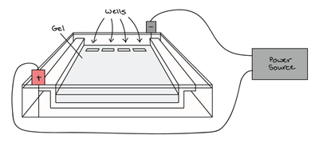

## Gel Electrophoresis

* Used to separate DNA fragments according to length

* Also used to separate different proteins according to mass/charge

* An electric field is used to move charged molecules through a gel

* DNA fragments are negatively charged due to the phosphate groups along the sugar-phosphate backbone

  * Therefore, they move toward the anode when an electric current is applied

### Components:

1. Gel: 2 types, **polyacrylamide** and **agarose**

* Polyacrylamide gel separates fragments that differ by as little as 1 nucleotide in length

* Agarose gel separates fragments that are 100-50000 base pairs in length

2. Buffer solution:

* This is a conducting solution in which the gel is submerged

* Maintains a constant pH level

3. DNA samples:

* DNA is amplified through PCR then cut into fragments using restriction enzymes

4. Apparatus:

* Gel tank, electrodes, and a power supply for an electric current

### Procedure:

1. The gel is prepared by dissolving a powder in buffer solution then heated, then poured into an electrophoresis tank

2. A comb is placed at one end, and when the gel solidifies the comb is removed, leaving wells (holes)

3. Buffer solution is poured in so that it covers the gel

4. DNA samples are mixed with tracking dye, to show how far the DNA travelled across the gel

5. A micropipette is used to load the DNA samples into wells at the negative end of the gel (cathode)

6. A **DNA ladder** with fragments of known lengths is placed into a well at one or both sides, as a reference to determine the lengths of the DNA fragments in the samples

7. A direct current is applied through the gel, causing DNA fragments to move through the gel towards the anode

8. When the dye has moved across most of the gel, the current is switched off

9. The buffer solution is poured away, and a stain that fluoresces under UV light is added (e.g. ethidium bromide)

* The stain is rinsed away to show bands across the gel where DNA fragments are

* The fragments’ lengths are determined by comparing them with the DNA ladder

* Smaller fragments travel faster and further than larger fragments

* Highly charged molecules move faster than those with less overall charge

### DNA Profiling

* Tandem repeats are nucleotide sequences arranged in a repetitive pattern

* Each person has unique tandem repeats, inherited from their parents

* PCR amplifies these sequences and gel electrophoresis separates them by size

* These sequences are used in forensics and paternity testing

**Minisatellites:**

* These are also known as Variable Number Tandem Repeats (**VNTR**s)

* Consists of large sequences, **10-100** base pairs long, repeated many times

* Used in early methods of genetic fingerprinting

**Microsatellites:**

* Known as Short Tandem Repeats (**STR**s)

* Consists of smaller sequences, 2-5 base pairs long, repeated many times

* Used in modern DNA profiling, replacing minisatellites