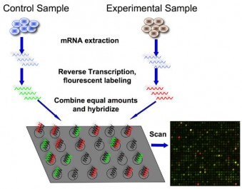

## Microarrays

- Used to:

1. Identify which genes are expressed

2. Distinguish between alleles of a gene

3. Measure the extent to which a gene is expressed

* To distinguish between alleles, DNA is used, while mRNA microarrays identify expressed genes because transcription produces mRNA

  * If a gene is expressed, there will be high levels of its mRNA

  * If a gene is inactive, there will be little to no mRNA

* For example, when comparing normal and cancer cells, the normal cells act as a control when the levels of mRNA are compared:

  * We can check which genes are expressed in cancer cells but not normal cells, OR which genes are expressed more/less than usual

### Structure:

* A microarray chip has over 10000 cells, each holding many copies of a **probe** (short lengths of single-stranded DNA)

* Each probe is complementary to specific gene, allele, or DNA sequence

* Different cells have different types of probes

### Process:

1A. To distinguish between alleles of a gene:

* DNA is extracted from the 2 samples and cut into fragments using restriction enzymes

* The DNA is denatured into single-stranded DNA (ssDNA) through heating

1B. To identify which genes are expressed:

* mRNA is collected from the cells of the 2 samples

* It is used as a template to form complementary ssDNA, using reverse transcriptase

* The quantity of cDNA may need to be increased by PCR, as the quantity of mRNA in a cell at one time is small

2. The ssDNA is labelled using fluorescent tags

* Usually red and green e.g. the red for cancer cells and green for normal cells

3. The labelled DNA samples are mixed together and allowed to hybridise with the probes on the microarray

* Any DNA that does not bind is washed away

4. UV light is used to inspect the microarray, causing the tags to fluoresce

* The fluorescence indicates hybridisation

* **Green** and **red** fluorescent spots indicate where DNA from one species has hybridised with the probes, so the gene is active in either one

* **Yellow** spots indicate that both species hybridised with a probe, meaning both species have DNA with exactly the same base sequences (i.e. same active genes)

* **No color** (**grey/blue**) means no DNA has hybridised with the probe, so the gene is absent or inactive in both species

* Intensity of light emitted by each spot is proportional to the level of gene expression/activity

  * High intensity indicates many mRNA molecules were present in the sample

  * Low intensity indicates there were very few

### Applications:

1. Genetic screening: distinguish between alleles of a gene

2. Drug testing: identify which genes the drugs have acted on

3. Identify genes that are overexpressed or not expressed in diseases