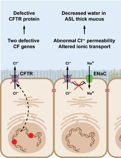

## Genetic Screening

* **Genetic screening**: The analysis of a person’s DNA to check for the presence of a particular alleles

* Types of genetic screening:

  
  |Screening type|Description|
  |:---|:---|
  |PGD: Pre-implantation Genetic Diagnosis|Screens embryos before implantation; Parents can select healthy embryos|
  |Prenatal Screening|Screens fetuses|
  |Newborn Screening|Screens newborn babies|
  |Carrier Screening|Identifies the risk of a symptomless parent passing on recessive allele to children e.g. screening for cystic fibrosis|
  |Presymptomatic Screening|Identifies people at risk of developing genetic diseases later in life e.g. screening for breast cancer or Huntington’s|

### Prenatal Diagnosis

1) **Amniocentesis:**

* Needle is used to withdraw foetal cells from amniotic fluid to be analysed

* Done at 15-16 weeks of pregnancy

* Ultrasound scanning is used

2) **Chorionic villus sampling** **(CVS):**

* Suction tube is used to remove foetal cells from the **chorion** (where the placenta will develop)

* Done at 10-13 weeks of pregnancy

3) **Non-invasive prenatal screening (alternative):**

* DNA fragments of placenta cells have the same genotype as the fetus, and can get into maternal circulation

* These fragments can be isolated from blood samples and tested

Advantages of prenatal diagnosis:

1. Early detection of genetic conditions

2. Helps parents make informed decisions

* Parents can consider alternatives or prepare emotionally

3. Early treatment can be given to the newborn

4. Reduces risk during delivery, as doctors can prepare better

5. Pregnancy can be terminated early for medical reasons

### Cystic Fibrosis:

* Mucus in airways is thick and sticky so cilia cannot remove it, and coughing doesn’t either

* Caused by a **recessive** mutation in the gene that codes for **CFTR**, which is located on chromosome 7

* CFTR is a transporter protein: Cystic Fibrosis Transmembrane conductance Regulator

* The genetic test involves sequencing the 2 alleles of the CFTR gene, to detect mutations or alterations in the gene sequence

* **Pulmonary ionocytes** are cells in the airways with the highest concentrations of CFTR

* In healthy people, the ionocytes pump Cl⁻ ions out through CFTR transporter proteins to decrease water potential outside the cells

  * This makes water move out by osmosis through aquaporins

* The water mixes with a thick and sticky mucus, making it thin enough for cilia to remove easily

* In people with CF, there are fewer numbers of working CFTR proteins, so much less water moves out of the cells and therefore the mucus stays thick and sticky, which is difficult for the cilia to remove

### Breast Cancer:

* Caused by mutations of the genes *BRCA-1* and *BRCA-2*, which are **dominant** genes

* These genes code for proteins (BRCA1 and BRCA2) that inhibit tumor development

* The proteins move to the site of any DNA damage and attract other proteins to initiate repair of the damage

* BRCA1 also activates **p53**, a protein involved in activating cell death if DNA damage is not repaired

* The absence of these two proteins results in failure of DNA repair mechanisms

* Knowledge of genetic mutations in the 2 genes can influence treatment decisions such as:

  * Chemotherapy

  * Hormonal therapy (**Tamoxifen** drug which blocks oestrogen action on breast tissue)

  * Removal of 1 or both breasts (prophylactic mastectomy)

  * Removal of the ovaries (prophylactic oophorectomy)