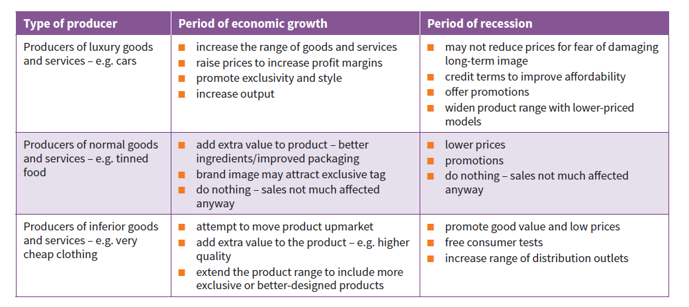
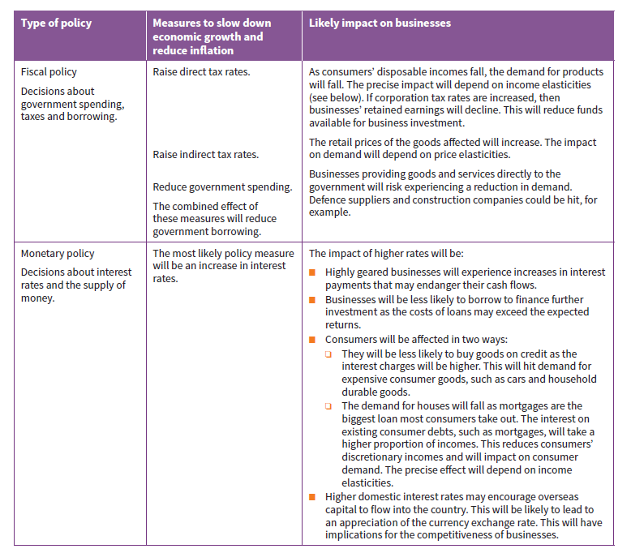

## Economic

### **Government Support for Business Activity**

* Governments can intervene by supporting or subsidizing start-ups, small businesses, and existing firms

**Government Assistance for Entrepreneurs**

* **Most governments provide special aid to entrepreneurs and other small business owners. This includes:**

  * Offering loan guarantee schemes - guarantee repayment of part of a loan if a start-up or small business fails.

  * Providing information, advice, and training through government departments and local colleges.

  * Financing low-rent workshops for entrepreneurs and small businesses, especially in high-unemployment areas.

  * Reducing paperwork and legal formalities for setting up businesses.

  * Reducing profits tax for new and small businesses, allowing them to retain more profit for expansion.

### **Government Assistance for All Businesses**

* **Governments also often intervene to support both small and large businesses through measures such as:**
  * Subsidies to reduce prices
  * Subsidies to aid failing businesses and protect employment
  * Grants to relocate to high-unemployment areas
  * Financial aid to consumers who buy products that increase national output

|Benefits of subsidies|Limitations of subsidies|
|:---|:---|
|Preventing business failure avoids rising unemployment.|Government must raise taxes or cut spending to fund subsidies.|
|This also keeps suppliers in business|Subsidies reduce incentives for businesses to improve efficiency.|
|Business failure may lead to consumers buying imported goods, worsening the balance of payments|Lower prices on subsidised products lead consumers to spend less on unsubsidised items, distorting the market.|

### **How Governments Address Market Failure**

* Free markets should operate efficiently to match demand and supply at equilibrium prices, ensuring effective resource allocation. However, critics argue that free markets do not take into account external costs, such as environmental impacts, leading to inefficient use of resources. Failure to allocate resources efficiently is known as market failure

### **Examples of Market Failure**

The examples below illustrate market failure and its relevance to business and government decision-making.

1. **External costs:** Pollution from manufacturing is a common external cost. Businesses pay for private costs like land, labor, and materials, but side effects like air pollution, noise, and waste disposal often aren't included in prices. When businesses don't cover these costs, society bears the burden through higher taxes for clean-up and healthcare. This leads to overproduction and is an example of market failure.

2. **Labour training:** Businesses often avoid training employees due to the risk of them being poached by competitors. This results in a shortage of skilled workers and slows economic growth, representing under-provision and market failure.

3. **Monopoly producers:** Monopolies restrict output and raise prices to maximize profits, leading to under-provision of goods and market failure by preventing competition and reducing supply.

### **Correcting or controlling market failure**

The table below considers the stakeholders impacted most by the examples above and potential government intervention

|Examples of market failure|Stakeholder groups most affected|Potential stakeholder reaction and government intervention|
|:---|:---|:---|
|**External costs - Pollution from Production**|**Consumers** may be forced to buy environmentally harmful goods, if no alternatives are present. **Governments** will be forced to take the issue seriously by voters and pressure. **Workers** may fear pollution's health effects and job security if the business shuts down.|A business may reduce external costs if bad publicity damages its reputation and sales. Government can fine polluting businesses or enforce strict pollution limits|
|**Labour training - Insufficient provision of skills training**|**Consumers** may receive bad customer services if workers are poorly trained. **Government** will worry about international competitiveness if skill workers are not sufficient. **Shareholders** might see profits fall as output falls below potential|Industry groups like the Engineering Employers Federation could fund industry-wide training to benefit all businesses. The government could fund training courses at colleges through general taxation.|
|**Monopoly producers - Limiting output of goods to maintain high prices**|**Consumers** face lack of choice, restricted supply and high prices. Monopolies may not develop new goods as there is limited competition. **Government** is concerned about high prices and a lack of competitiveness in key industries.|**Consumers** through the internet can choose from a wider range of suppliers, breaking down some monopoly situations. **Governments use competition laws**|

### **Macroeconomic objectives of governments**

* Governments set targets for the whole economy, known as macroeconomic objectives. These include:

  * **Economic growth** - annual % increase in a country's total output (GDP) measured by real GDP changes

  * **Low price inflation** - rate of consumer price increase

  * **Low unemployment rate**

  * **Long-term balance of payments** between value of imports and exports

  * **Exchange rate stability** - prevent swings in the external value of the currency

* The objectives may conflict with each other. For example, reducing inflation by cutting spending could lead to increased unemployment.

### **How Economic Objectives and Performance Affect Business Operations**

* Economic growth, low inflation, and low unemployment are key factors that impact business activity.

### Economic Growth

* **Economic growth** is measured by **GDP** and means a country is getting richer.

* **GDP** is measured in monetary terms and the value of **GDP** is raised by **inflation**. Such an increase is not true **economic growth**. True **economic growth** occurs when the **real level of GDP** increases due to the actual production of goods and services.

* Economies aim to achieve consistent growth, with varying success. The US experienced GDP growth rates between -2.3% to 3% from 2009-2018, while China averaged 8% growth over the same period. Negative growth occurs when GDP falls, as seen in Zimbabwe (-17% in 2008) and Venezuela (-25% in 2018).

### Advantages of Economic Growth

* **It can lead to the following benefits**

  * Raising average living standards if population growth is slow

  * Increased employment, reduced unemployment and increased consumer incomes

  * Allow for more resources to be devoted to public projects like health and education

  * Reduce absolute poverty and make benefits more widespread

  * Boosts business demand for products (depending on income elasticity of demand)

  * Provide more government revenue through taxes and reduced social benefits

### Causes of economic growth

* **Technological changes and industrial expansion:** encouraging business investment and innovation in new industries and products

* **Increases in economic resources:** higher worker population, new natural resources, or discoveries

* **Increases in productivity:** A more skilled workforce and willingness to adopt new technology

### **The business cycle**

Economies grow at different rates over time

* **Boom**

  * Period of rapid economic growth with rising income and profit

  * Rising inflation

  * Shortage of skilled workers and higher wage rates

  * Increased interest rate to combat inflation

* **Recession**

  * Falling demand and rising interest rates start to take effect

  * Real GDP growth slows down

  * Income and consumer demand falls, profits are reduced

  * Some businesses make loss and others fail completely

  * Underperformance 

* **Slump**

  * Very serious

  * GDP falls significantly

  * Product and asset prices fall

  * More likely to occur if government fails to take corrective action

* **Recovery and growth**

  * All downturns eventually lead to recovery when real GDP begins to rise

  * This is due to corrective government action taking effect

  * Lower product prices increase the competitiveness of a country's exports, increasing demand for them

### **Is a recession always bad?**

* During a recession, output falls, unemployment rises, the income and demand falls
* Government revenue also falls as less income and sales tax is received
* Luxury product businesses face reduced demand, creating spare capacity
* **However, there are opportunities businesses could seize:**
  * Capital assets like factories may be cheaper, allowing businesses to invest in expectation of recovery.
  * Demand for inferior goods may rise.
  * Job loss fears could improve employer-employee relations, increasing efficiency
  * Closing factories and offices can reduce costs, enabling businesses to benefit from future economic growth.

### **Inflation and deflation**

* The spending power of a dollar is the amount of goods it can buy.

* The spending power of money can change over time

* If it buys fewer goods than last year, the value has fallen due to **inflation**

* If it buys more, the value has risen due to **deflation**

**Causes of inflation**

Prices rise either due to businesses increasing them to cover rising costs or to capitalize on high demand for extra profits. These causes can be seen as:

1. **Cost-push causes of inflation:**

* Businesses face higher production costs due to:

  * Lower exchange rate increasing price of imported materials

  * World demand increasing price of materials

  * Higher wage demanded by workers, in order to maintain their real living standards

2. **Demand-pull causes of inflation:**

* During an economic boom, rising consumer demand allows producers and retailers to sell at higher prices

* If prices aren't raised, inventories may run out, leading to unsatisfied demand

### **The effect of low inflation on business decisions**

**Low inflation can have benefits for businesses:**

* Cost increases can be passed to consumers more easily during general price inflation.

* The real value of company debts decreases, benefiting businesses that rely on loans.

* Fixed assets like land and buildings may rise in value, rising business financial security.

* Buying inventories in advance and selling later increases profit margins due to inflation.

### **The impact of high inflation on business decisions**

**Higher rates of inflation (such as 6% a year) can have major drawbacks for business:**

* Employees may demand higher wages to keep up with inflation

* Consumers might look for bargains over brand names

* Rapid inflation often leads to higher interest rates, which can strain heavily indebted companies

* Cash flow issues may arise as businesses struggle with rising material costs

* Higher domestic inflation can reduce a country's competitiveness abroad

* Businesses may limit credit terms due to concerns about repayment value

* Consumers might stockpile essentials and reduce spending on non-essentials

**High inflation also adds to uncertainty about the future:**

* Will price continue to rise?

* Will inflation increase again?

* Will the government need to take actions that might reduce business profits?

**Business decisions during rapid inflation may include:**

* Reducing investment spending

* Reducing profit margins and limiting price rises for competitiveness

* Reducing borrowing to manage interest payments

* Reducing payment periods for trade receivables

* Reducing labour costs

### **Is deflation beneficial?**

* Here's why most businesses don't benefit from deflation:

  * Consumers delay important purchases. This reduces demand and risks recession

  * Discourages investment, as businesses with debts have to repay with more valuable money

  * Falling prices make future profitability of new investments doubtful

  * Inventories lose value, leading to businesses minimising stock

### **Unemployment**

* Members of the working force who are willing and able to work, but cannot find a job

### Causes or types of unemployment

* **Cyclical employment:**

  * Caused by demand falling for products during a recession

  * Businesses need less workers as output falls

  * Unemployed and employed workers have lower incomes and spend less, worsening the recession

* **Structural employment:**

  * Exists during rapid growth

  * Certain workers are unable to find jobs, despite jobs existing in growing industries

  * This occurs due to structural changes in the economy, changing demand of labour

  * **The most likely causes are:**

    1. Changing consumer tastes and spending patterns

    2. Increased use of technology is replacing workers, with new employers seeking adaptable, multi-skilled employees. Unskilled workers unable to adapt to these new requirements.

    3. Decline of heavy manufacturing industries, leading to workers losing jobs and unable to transfer skills to other industries.

* **Frictional employment:**

  * Unemployment when a worker loses their job and are trying to find a new one

  * Results from changes in labour demand across industries which are occuring all the time

  * Increased labour turnover rates raise the level of frictional unemployment

### **Cost of unemployment**

* Economic output is lower, reducing living standards

* Supporting unemployed workers burdens taxpayers

* May lead to social issues like crime

* Lowers demand for goods by reducing incomes

* Reduced incomes and living standards

* Prolonged unemployment makes finding jobs harder as skills become outdated

### **Effects of unemployment on business operations**

* Reduced demands due to reduced income

* Recruiting new employees is easier with more applicants per vacancy

* Workers may accept lower pay raises due to job insecurity

* Government grants and subsidies may support job creation

### **How governments achieve macroeconomic objectives**

* Governments use **monetary, fiscal, supply-side, and exchange rate policies** to achieve macroeconomic objectives

* Each policy has a different impact on business and business decisions

### Monetary policy

* Monetary policy focuses on adjusting interest rates set by the central bank to meet government inflation targets

* Central banks, in most countries, are given inflation targets by the government and they use interest rates to obtain them

* When inflation is expected to exceed targets, the central bank raises interest rates, and all other banks will follow, typically during economic growth

* If inflation is low and growth is weak, the central bank may lower interest rates to prevent unemployment. The primary aim is inflation control

### Impact of monetary policy on business and business operations

Higher interest rate affects businesses in three ways:

* Increased interest costs reduce profits for businesses with high debts

* Lower consumer borrowing reduces demand for credit-based goods (e.g., houses, cars).

* Higher interest rates often lead to currency appreciation

### Fiscal policy

* Involves decisions on government spending and tax rates

* Tax revenue is raised by the government to pay for these schemes

* Tax revenue mainly is generated through income tax, VAT, corporation tax and excise duties

* In the annual budget, the finance minister announces spending, tax, and borrowing plans

* The difference between spending and revenue is the budget deficit or surplus

### Impact of fiscal policy on business and business operations

* Many fiscal policy changes are insignificant and affect individual product market. Overall changes in total tax revenues or government spending have widespread macroeconomic effects on all businesses. These changes may impact certain businesses but do not significantly affect the overall macroeconomy

‌‌‌

**The government is likely to make these significant changes under certain circumstances:**

* **Situation 1: The economy is in recession and unemployment is rising**

  * Results from aggregate demand for domestic goods falling below potential output

  * government aims to boost demand to promote economic growth and reduce unemployment

* **This can be achieved by:**

  * Increasing government expenditure

  * Reducing taxes to raise disposable incomes for consumers and businesses

* Higher disposable incomes encourages spending

* Known as **expansionary fiscal policy** and typically results in a **budget deficit**‌

‌‌‌

* **Situation 2: The economy is booming and in danger of overheating**

  * A booming economy can lead to both higher inflation and a large balance of payments deficit

  * This results from excess aggregate demand

* **The government can respond by:**

  * Reducing spending, directly lowering demand

  * Increasing taxes, reducing disposable income for consumers and businesses

* Governments often cut investment spending rather than current spending, taking spending power out of the economy by leaving consumers and businesses with lower disposable income

* These actions are known as contractionary or deflationary policies

### **Summary of fiscal and monetary policy**

* The table below outlines measures the government and central bank can use to control a booming economy with high inflation. These actions are reversed if the economy moves into a recession.

### Supply-side policies

* Supply-side policies aim to increase industrial competitiveness by improving the supply efficiency of the economy, helping industries become more competitive globally

**The following policies may have these impacts:**

**1. Lowering rates of income tax**

* Staff lose motivation to work hard and seek promotions if they are forced to pay high income tax

* Entrepreneurs are discouraged from starting new businesses

* *Reducing* rates of income tax is a supply-side policy

* Low tax rates can encourage enterprise and increase incentives to work

* This discourages investments and as a result, reduces business competitiveness

‌

**2. Lowering the rate of corporation tax (profit tax)**

* Tax on profits of limited companies

* High profit tax rates reduce internal finance available for business reinvestment

* Low profit tax rates increases retained earnings and encourages investment

‌

**3. Improving labour market flexibility and labour productivity**

* Labour is a key economic resource. Most governments use policies to improve workforce skills and efficiency while promoting strong work incentives.

* **These include:**

  * Subsidies for worker training and increasing skills training at colleges

  * Higher education funding to improve employment with degrees and qualifications

  * Low income tax rates to encourage entrepreneurship and work incentives

  * Encouraging immigration of skilled workers to fill job vacancies and improve output

  * Restricting welfare benefits to those in genuine need

‌

**4. Expenditure on infrastructure projects**

* Government spending on dams and irrigation improves agricultural productivity

* New roads and railways improve transport efficiency, allowing exporters reach ports faster

* Reliable internet access promotes e-commerce and web entrepreneurs

‌

**5. Making business start-up easier**

* Reducing paperwork and setup time encourages new enterprises

* Creates new jobs and competition rises for existing firms, driving efficiency

### Exchange rate policy

* Exchange rates are determined by the supply and demand for a country's currency
* The table below summarises the factors influencing the demand and supply of a currency in the foreign exchange market

|Demand for currency|Supply for currency|
|:---|:---|
|Foreign buyers of domestic products|Domestic businesses purchasing foreign imports|
|Foreign tourists spending domestically|Domestic population traveling abroad|
|Foreign investors buying currency, for example, to benefit from higher domestic interest rates|Domestic investors seeking foreign currency, for example, to buy foreign businesses|

* If currency supply exceeds demand, its price falls, leading to exchange rate **depreciation**. *For example*, if $1 drops from €2 to €1.5, the dollar has depreciated against the euro
* If demand exceeds supply, the price rises, resulting in exchange rate **appreciation**. *For example*, if $1 increases from €1.5 to €2, the dollar has appreciated against the euro

### **Exchange rate appreciation: Business winners and losers**

**Domestic businesses that gain from appreciation of the currency are:**

* **Importers of foreign raw materials and components** - Benefit from lower domestic currency cost of these raw materials and components

* **Importers of foreign manufactured goods** - Benefit from lower domestic currency cost of these imports

**Domestic businesses that lose from appreciation of currency are:**

* **Exporters of goods and services to foreign markets** - Fall in demand due to higher cost in foreign currency terms. This includes manufactured goods like cars and also services sold to customers abroad

* **Businesses selling to the domestic market that have foreign competition** - Appreciation makes imports cheaper, making domestic producers less competitive

### **Exchange rate depreciation: business winners and losers**

**Domestic businesses that gain from depreciation are:**

* **Exporters** - Can now lower prices in overseas markets, improving competitiveness. This increases export value and leads to expansion of their business

* **Domestic businesses** - Less competition from importers as imports are now more expensive.

**Domestic businesses that lose from depreciation are:**

* **Manufacturers who depend on imported raw materials and components** - Suffers as imports are now more expensive, increasing costs and reducing competitiveness

* **Retailers who buy foreign supplies** - Suffers as prices of these imports increase, increasing cost and reducing competitiveness, especially if there are domestic substitutes available

### **Exchange rate policy summary**

* Most governments aim to keep their currency's exchange rate stable to avoid the risks of large depreciations or appreciations

**However, some governments may allow or encourage:**

* Depreciation to increase domestic industry competitiveness

* Depreciation to cancel out competitiveness lost to high inflation, though it may increase inflation

* Appreciation to raise living standards by increasing import purchasing power and reducing inflation

* Some governments may join a common currency, like the euro used by most EU members in the eurozone. A common currency eliminates exchange rate fluctuations between member countries

**Alleged benefits of common currency:**

* It eliminates currency fluctuations between member countries, resulting in:

  * No price fluctuations for imported materials and components

  * No fluctuations in export prices, resulting in stable demand

  * No uncertainty over profits from trading or investing in other member countries

* It lowers costs for businesses trading with other member countries:

  * No need to convert other currencies into the domestic currency, therefore no bank commission payments

  * The same product price is set for all member countries

* It encourages inward investment from non-member businesses wanting to gain access to the common currency market

**Alleged limitations of common currency:**

* The European Central Bank sets interest rates for all member countries in the eurozone. This reduces individual central banks' control over interest rates

* A common currency may lead to common tax policies within the currency zone. This reduces individual governments' control over its own tax rates

* Each government cannot depreciate its currency to increase competitiveness

### **International competitiveness: non-price factors**

**Exchange rate depreciation is not the only factor affecting product competitiveness in global markets. Non-price factors are also significant:**

* **Product design and innovation:** Innovative products, like the latest Apple iPhone, attract customers even at premium prices

* **Quality and reliability:** Japanese cars are highly reliable, appealing to consumers despite not being the cheapest.

* **Effective promotion and distribution:** These two strategies explain the global success of McDonald’s

* **After-sales service:** Includes extended warranties

* **Investment in skilled employees and modern technology:** Increases production flexibility and labor productivity, overcoming drawbacks by higher resource costs