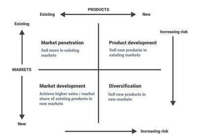
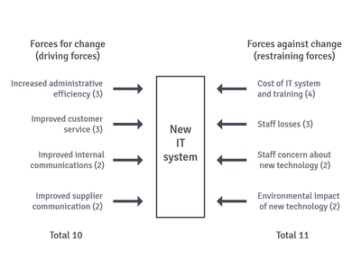
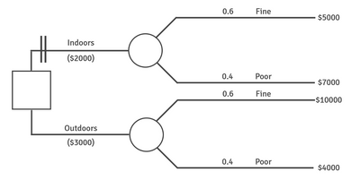

# Business Strategy

## Developing Business Strategy

### **Business Strategy: Meaning and Purpose**

* A strategy is how we get from where we are now to where we want to be.
* A successful business sets **SMART** objectives, and its business strategy will include a clear plan and policies to achieve its goals
* Business strategy asks the big questions, like, **'What markets and products do we want to focus on?'**. It also makes big decisions, like **'Is it possible to expand from manufacturing into retail?'**
* All businesses need strategies for integration, direction, and focus

### Establishing Business Strategy

**Four key factors influence business strategies:**

1. Resources available

2. Strengths of the business

3. Competitive environment

4. Objectives

**Resources Available**

* Business resources are finite.

* Limited resources require choosing which strategies to proceed with, drop, or scale back.

**Strengths of the Business**

* Businesses should develop strategies that complement their strengths

* Avoid long-term plans that stray from the business's area of expertise, as this may require skills and experience that it does not have

* Expansion may be best achieved by selling underperforming or non-core businesses

* The business will then focus on current successes to achieve growth

**Competitive environment**

* Competitors' actions heavily influence business strategy

* Innovations by competitors are difficult to replicate or improve

* All businesses operate in a competitive environment to some degree

**Objectives**

* Business objectives also influence strategy

* Increasing shareholder returns in the short-run may conflict with long-term R&D investments with a payback period many years into the future

* A business focused on the triple bottom line may prioritise other goals over shareholder returns

* Businesses with social responsibility objectives pursue different strategies than those focusing solely on shareholder value

### **Strategic Management: Meaning and Purpose**

* Once SMART objectives are set, the strategic management process has three key stages:

|**Strategic management stages**|**Key purpose**|
|:---|:---|
|**1. Strategic analysis:** assessing the company's current position in relation to its market, competitors, and external environment|Decisions made without knowing the business's current position may be inappropriate and ineffective|
|**2. Strategic choice:** making long-term decisions to drive the business toward its objectives|A new direction requires key decisions about products and markets|
|**3. Strategic implementation:** allocating resources to execute decisions and evaluating success|New strategies require additional resources, provided at the right time and in sufficient quantities to be effective|

* **Strategic analysis** examines a business's current position, what is happening now and what may happen in the future, to ensure long-term plans fit in with this external analysis. It addresses three key questions:
  1. Where is the business now?
  2. How might current or future events affect it?
  3. How could the business respond to these changes?

### **Strategic Choice**

* Strategic choice is the next stage after potential strategies are identified through strategic analysis

* Strategic choice evaluates the benefits and limitations of different options and then selects one

* Successful choices must be challenging enough to gain a competitive advantage, yet achievable and affordable with resources available

* Techniques can assist managers in making strategic choices, but judgement, experience, and skill are crucial.

### **Strategic Implementation**

* Without successful strategic implementation, effective change in an organisation is impossible**. Key factors for successful implementation include:**

  * Appropriate organisational structure for change

  * Adequate resources to support change

  * Motivated staff committed to successful change

  * Leadership style and culture that support change with wide-range support

  * Control and review systems to monitor progress toward objectives

### **Strategy and Tactics**

* Strategic management is the highest level of managerial activity, led by the CEO and approved by the board of directors

* Tactics involve smaller decisions focused on short-term, measurable goals that support long-term strategy

* Clear distinction between tactics and strategies is essential

### The Need for Strategic Management

* **If a business did not undertake strategic management, it would fail to:**
  * Plan for the future
  * Respond logically to changes in the business environment
  * Make effective long-term decisions based on clear objectives

|**Strategic decisions**|**Tactical decisions**|
|:---|:---|
|Long-term|Short to medium-term|
|Difficult to reverse|Reversible but may incur costs|
|Made by directors and/or senior managers|Made by less senior managers and subordinates with delegated authority|
|Cross-functional, involves all major departments|Impact often limited to one department|

### **Blue Ocean Strategy**

* The basis of this business strategy approach is to stop competing and start creating. Instead of focusing on markets with many competitors, further developing uncontested markets

* This requires adopting creative, original strategies to develop new markets or segments with no close competitors, known as **blue oceans**. On the other hand, highly competitive markets are called red oceans

  * **W. Chan Kim and Renée Mauborgne**, the creators of this approach, suggest that the best blue ocean strategies combine high product differentiation with low cost, making competition irrelevant

* The theorists suggest that exceptional business success lies in redefining competition and moving into the blue ocean, where competition becomes irrelevant

**To identify a blue ocean, Kim and Mauborgne propose the Four Actions Framework, which asks four key questions:**

* Raise: What factors, like quality or service, can be raised above industry standards?
* Reduce: Which competition-driven factors can be minimised?
* Eliminate: Which competitive factors can be removed entirely?
* Create: What factors should be introduced that the industry has never offered?

|**Red ocean strategy**|**Blue ocean strategy**|
|:---|:---|
|Compete in existing markets|Create uncontested markets to enter|
|Surpass competition|Make competition irrelevant|
|Exploit existing demand|Create and exploit new demand|
|High value to customer = high costs to business|High value to customer but low cost to business|
|Product differentiation **or** low cost|Product differentiation **and** low cost|

### Scenario Planning

* In a fast-changing world, the future of any business is uncertain
* Making fixed plans risks inflexibility and making no future plans risks unpreparedness
* Scenario planning involves senior managers identifying a few possible outcomes, or scenarios, which they then discuss strategies the business could adopt for each scenario should they occur
* Scenarios will vary for each business, based on key risk factors such as **social, economic, technological, or competitive influences**
* Scenario planning is used not only by businesses but also by major non-profit organisations like **Amnesty International, Oxfam, Greenpeace, and the Red Cross** to enhance strategic thinking

|**Benefits**|**Limitations**|
|:---|:---|
|Forces managers to consider key risks and uncertainties|Risk of confusion if too many uncertainties are considered|
|Managers develop multiple strategies for different scenarios|Some may focus on one scenario, leaving them unprepared for others|
|Encourages flexibility, as different scenarios require different strategies|Less effective if only short-term risks are considered. Long-term thinking leads to creativity|

### **SWOT Analysis**

* SWOT analysis helps match a firm's resources and strengths to its competitive environment

* SWOT is a widely used tool for identifying future strategies, comprising of:

  * **Strengths**: Internal advantages, like experienced management, patents, a loyal workforce, or a strong product range. Identified through an internal audit.

  * **Weaknesses**: Internal disadvantages, such as a poorly trained workforce, limited capacity, or outdated equipment. Also identified via internal audit.

  * **Opportunities**: Potential areas for growth and profit, like new technologies or expanding export markets. Identified through an external audit of the market and competitors.

  * **Threats**: External risks, such as new competitors, price drops due to globalisation, or legal and policy changes. These are identified through an external audit.

**SWOT and Strategic Objectives**

* **SWOT** helps managers assess likely successful strategies and their constraints

* A business can gain a competitive advantage by matching strengths with opportunities, though overcoming weaknesses may be necessary

* **SWOT** is a common starting point for strategy development, however it is rarely sufficient

* Further analysis and planning are typically required

**Evaluation of SWOT**

* Subjectivity is a limitation of **SWOT**, as managers may disagree on assessments

* It’s not quantitative, so costs of correcting weaknesses cannot be compared to potential profits from opportunities

* **SWOT** should guide strategy development, not dictate future actions

* A key benefit of SWOT is the greater understanding it gives senior managers about their business

### **PEST Analysis**

* Another form of strategic analysis that focuses on the macro environment where a business operates
* The macro environment refers to broad, major factors that influence a business's future strategies
* **PEST analysis** *is an acronym for:*
  * **P** = political (and legal) factors
  * **E** = economic factors
  * **S** = social factors
  * **T** = technological factors
* **PEST analysis** assesses the likelihood of a business strategy's success
* It covers four key external factors beyond the business's control
* These factors are viewed as either opportunities or threats
* **PEST** complements **SWOT**, rather than replacing it

**Evaluation of PEST**

* Any new business strategy should start with analysing the wider environment in which the strategy has to operate and succeed
* **PEST analysis** formalises this process and informs strategy development
* **PEST analysis** should be regularly updated and reviewed, especially in changing environments
* *For multinational businesses*, **PEST analysis** should be done for each country they operate in:

|**Political and legal**|**Economic**|**Social**|**Technological**|
|:---|:---|:---|:---|
|Government stability|Economic growth rate|Demographic changes|New technology enabling cheaper production of products|
|Likely legal changes effecting this industry|Exchange rate stability|Dominant religion and effect on marketing strategies|Government support for research funding|
|Environment regulations|Country's membership of free-trade areas|Education standards and effect on labour skills|Effect of internet access and speed on marketing and other strategies|
|Employment laws|Membership of a common currency|Role of men and women|Cost of renewable energy vs. fossil fuels|
|Competition regulation|Tax rates and likely changes|Social and environmental issues may increasingly concern the public|Rate of technological obsolescence|
|Consumer protection laws|Interest rates and likely changes|Labour, social mobility and migration levels|Importance of product innovations to consumers|
|Government attitude on the free market and business regulations|Inflation rates, stage of the business cycle|One or many languages spoken|Process innovations and effects on competitiveness|

### **Porter’s Five Forces Analysis**

* Michael Porter's framework for industry analysis consists of **five forces**

* Managers can use it to develop strategies and gain a competitive advantage

* It is similar to other external audit tools like **PEST analysis**

* **Five forces analysis** focuses on entire business units, not individual products

* Helps understand the industry a business operates in

**1. Barriers to entry**

* **This refers to how easily new firms can enter the industry and compete. The threat of entry is highest when:**

  * Economies of scale are low in the industry

  * Technology required to enter the industry is cheaper

  * Distribution channels are easily accessible

  * No legal or patent restrictions on entry

  * Low product differentiation, so minimal advertising is needed to establish

**2. The power of buyers**

* This refers to the power customers hold over producers

* For example, in a market dominated by a few large supermarkets, their buyer power is strong

* **Buyer power increases when**

  * Many small, undifferentiated suppliers exist

  * Cost of switching suppliers is low

  * Buyers can easily switch to other suppliers

**3. The power of suppliers**

* **Suppliers are more powerful than buyers when:**

  * Switching costs are high *(e.g., Microsoft to Mac)*

  * The brand is strong and well-known *(e.g., Cadbury, Nike)*

  * Suppliers can threaten forward integration *(e.g., coffee suppliers opening cafes)*

  * Customers are small and fragmented, have little bargaining power *(e.g., independent petrol stations)

**4. The threat of substitutes**

* In Porter’s model, substitute products refer to alternatives from different industries, not direct competitors (e.g., glass or plastic instead of aluminum)

* **Substitution threats arise when:**

  * New technology offers alternatives *(e.g., satellite TV replacing antennas)*

  * Price competition leads customers to consider other options *(e.g., lower bus fares instead of rail)*

  * New products shift consumer spending *(e.g., more spending on phones reduces spending on clothes)*

**5. Competitive rivalry**

* This is the key part of the analysis, summarising the factors that determine competition levels in an industry, based on the other four forces

* **Competitive rivalry is highest when**

  * New firms can easily enter the industry

  * Threat from substitute products

  * Suppliers have significant power

  * Buyers have significant power

* **Rivalry intensifies when:**

  * Many firms have similar market shares

  * High fixed costs force firms to seek economies of scale

  * Slow market growth forces firms to take market share from rivals to increase sales

**Porter’s five forces as a framework for business strategy**

**Analysing the competitive situation in an industry helps strategic decision-making by:**

* Helping businesses determine whether to enter an industry based on potential profitability and competition levels

* Analysing existing markets, decisions may be taken regarding:

  * Staying in markets that are becoming more competitive

  * Reducing competitive rivalry to increase profitability

* Knowledge of competitive forces allows businesses to develop strategies to improve their competitive position

**Evaluation of the five forces model**

* Porter’s model enables managers to analyse the current competitive structure of their industry in a logical way

* It usually serves as a strong starting point for business strategy

* **However, it faces criticism for:**

  * Being a static analysis that captures only a single moment in time, while many industries rapidly change due to globalisation and technology

  * Becoming overly complex when applied to modern industries with joint ventures, multiple product groups, and varying market segments, each with their own competitive forces

### **Core competencies**

* This concept was first analysed in the work of **Gary Hamel and C. K. Prahalad**

* They argued that developing core competencies can provide a competitive advantage which helps businesses outperform rivals

* **For a core competence to be commercially and profitably beneficial, it should:**

  * Provide clear benefits to consumers

  * Be difficult for competitors to replicate *(e.g., a patented design)*

  * Be applicable across various products and markets

* **According to Prahalad and Hamel:**

  * Core competencies lead to the development of core products

  * Core products are not sold directly to consumers; instead, they are used to produce a large number of end-user products.

**Developing core competencies**

* A business may excel in a specific activity, but it does not mean it is a core competence if it is not exceptional or easily replicable

* According to Prahalad and Hamel, developing a core competence involves integrating multiple technologies and product skills, some of which may already exist within the business

* Core competencies do not always require significant R&D investment; for instance, patented processes can contribute to core competencies

* Effective collaboration among designers, production specialists, and IT experts can create differentiated core competencies

**Core competencies and strategy**

* Once a core competence is established, it creates strategic opportunities for developing core products and entering new markets

* Core competencies could include innovations like a fast microchip or a unique electric motor design

* Developing new products for new markets increases opportunities to achieve economies of scale in core product manufacturing

### **The Ansoff matrix**

* The Ansoff matrix is a key tool for assessing corporate business strategies and planning their introduction
* Developed by **Igor Ansoff**, it analyses options for marketing managers to explore sales growth
* **It highlights two main variables in strategic marketing decisions:**
  * Market in which it will operate
  * Product(s) it plans to sell
* **Managers have two options in terms of market:**
  * Remain in the existing market
  * Enter new markets
* **The options in terms of product are:**
  * Sell existing products
  * Develop new products
* **When placed in a matrix (diagram below), these two options for markets and products create four distinct strategies for increasing sales. These strategies are summarised in the matrix**

**Market penetration**

* Samsung cut European 4K TV prices by up to €1,200 to increase market share
* Market penetration, the least risky Ansoff strategy, keeps market and product constant
* However, low prices may trigger a price war, hurting profit margins

**Product development**

* Diet Pepsi adapted an existing product and sold it in the same soft drinks market as Pepsi
* Product development often includes innovation, like 5G phones, giving the business a unique identity

**Market development**

* Market development could involve exporting or targeting new segments
* Lucozade shifted from a health tonic to a sports drink for younger consumers
* Dell and HP can repackage business computers for consumers

**Diversification**

* The Virgin Group has diversified from media to airlines, trains, and finance
* Tata Industries is also highly diversified, producing steel, cars, and tea bags
* Related diversification (e.g., vertical integration) is less risky than unrelated diversification into new industries
* Diversification is the riskiest strategy as it involves new markets and products, often outside a firm's **core competencies**
* Despite the risk, it offers high profit potential and opportunities in growing industries

**Evaluation of the Ansoff matrix**

* **The risks of the four strategies differ substantially**. The matrix helps managers assess risks for each expansion strategy. Managers can then assess costs, potential gains, and risks for all options using decision-making techniques
* **Ansoff’s analysis helps map business strategies but has limitations**
  * It only considers two factors, so managers should also use SWOT and PEST analysis
  * Relying solely on the Ansoff matrix overlooks important environmental factors
* Management judgment, based on experience with risks and returns, is **just as important as any analytical tool in making the final choice**
* **The matrix does not provide detailed marketing options**. For market development, it does not specify the market or which products to use. Further research and analysis are needed to address these gaps

### **Force-field analysis**

* First developed by **Kurt Lewin**, it involves looking at forces for and against a decision
* It assesses potential advantages and disadvantages before making a choice
* The goal is to help managers strengthen supportive forces and reduce opposing ones
* It can be used for decisions like introducing a new product or service or implementing internal changes in business
* It uses a force-field diagram to display forces for and against a major change visually

**Conducting a force-field analysis**

1. Analyse the current and desired situation
2. List all driving factors towards the desired situation
3. List all constraining factors against the desired situation
4. Allocate a score (1-10) to each force based on its scale or significance
5. Chart driving forces on the left and restraining forces on the right
6. Total the scores to assess whether the change is viable; if yes, proceed
7. Consider ways to decrease restraining forces and increase driving forces for greater success

**In the diagram below, forces opposing the new IT system outweigh those supporting it (11:10). Pushing the decision forward without addressing these concerns could lead to staff resistance and lack of cooperation**

* **Management strategies to address restraining forces include**

  * Training employees to reduce tech concerns **(+1 cost, -2 staff concern)**
  * Show staff change is crucial for business survival **(+2 in favor)**
  * Highlighting new IT skills and job interest **(+1 in favor)**
  * Offering wage increases for productivity **(+1 cost, -2 staff turnover)**
  * Choosing energy-efficient IT equipment **(-1 environmental impact)**

* **These changes shift the balance from 11:10 against to 13:8 in favor of implementing the IT system**

**Evaluation of force-field analysis**

* **This technique is widely used to assess strategic decisions involving major internal changes but has two main limitations:**
  * Inexperienced or unskilled managers may overlook all relevant forces in the change process
  * Allocating numerical values to forces is subjective, leading to potentially different outcomes from different managers.

### **Decision trees**

* One method for evaluating options and their probabilities is decision trees
* It uses a diagram to represent the four main aspects of a business decision
  * Available options for the manager
  * Possible outcomes of each option
  * Likelihood of each outcome
  * Economic returns from each outcome

**Constructing decision trees**

* **The decision tree diagram includes these features:**
  * It is constructed from left to right
  * Branches represent options, their outcomes, and their probabilities
  * Squares indicate decision points (decision nodes); circles show chance nodes
  * Probabilities are shown for each outcome
  * Economic returns reflect expected financial gains or losses for each outcome

**Working out expected values on decision trees**

* Tossing a coin with a **5 dollar** win for heads has an expected value of **2.50 dollars** (0.5 × 5). A decision tree helps identify the option with the highest expected value.
* **For example:** The manager of an event organisation must decide between holding a fundraising auction indoors or outdoors, with the financial success depending on both the weather and this decision.
  * Weather data for August indicates a **60% chance of fine weather** and a **40% chance of poor weather**. The indoor event costs **2000 dollars**, while the outdoor event costs **3000 dollars**.
  * The table below presents expected returns from the event under various circumstances

|**Weather**|**Indoors**|**Outdoors**|
|:---|:---|:---|
|Fine|$5000|$10000|
|Poor|$7000|$4000|

* **The decision tree of the event is shown below. It demonstrates the main advantages of decision trees:**

  * They compel decision-makers to evaluate all options and variables
  * They provide a clear diagram that incorporates numerical risk and economic returns
  * This method encourages logical thinking and discussion among managers

* **To find the highest expected value for holding the event indoors or outdoors:**

  * Calculate the expected value at each chance node by *multiplying the probability by the economic return for both outcomes and adding the results*
  * Subtract the cost of each option from this value for the net return, *working through the tree from right to left*
    * Expected value at node 1 is $5800
    * At node 2, $7600
    * **Subtract the cost of holding the event indoors or outdoors**
      * **indoors** = 5800 – 2000 = 3800
      * **outdoors** = 7600 – 3000 = 4600

* The events manager should hold the event outdoors, as it offers the highest expected value. The other option is blocked with a double line in the decision tree below to show it's not chosen.

### **More complex decision trees**

**Evaluation of decision trees**

* **Potential limitations of this technique include:**
  * **Data accuracy:** Economic returns may be reliable for familiar projects but are often based on market forecasts, making decision-tree analysis only a general guide.
  * **Probability reliance:** Probabilities based on past data may not hold if conditions change, such as new competition affecting a store’s success.
  * **Risk and qualitative factors:** Decision trees assist but cannot replace risk assessment or qualitative considerations like environmental impact or management's risk tolerance.
  * **Single outcome limitation:** Expected values reflect averages over multiple occurrences, so for one-off decisions, the actual result may differ, leaving risks uneliminated.