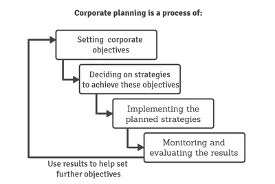
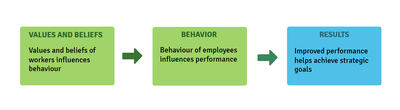

## **Corporate Planning and Implementation**

### **Components of corporate plans**

* **A typical corporate plan includes:**
  * Overall objectives such as profit, sales growth, or market share within a set timeframe
  * Strategies to meet objectives:
    * **Market penetration** - increase sales of existing products
    * **Market development** - develop new markets for existing products
    * **Product development** - develop new products for existing markets
    * **Diversify** - new products for new markets
  * Main objectives for important departments in line with overall objectives

### Potential benefits of corporate plans

* Senior managers maintain a clear focus and purpose, selecting strategies with the best chance of achieving set objectives

* The plan communicates this focus to managers, employees, and stakeholders, ensuring effectiveness across businesses, no matter its size

* A key benefit of corporate planning is the ability to compare objectives with actual outcomes, assessing performance

* The planning process itself is a very useful exercise, and forces senior managers to evaluate the organisation's strengths and weaknesses in relation to the business environment

### Potential limitations of corporate plans

* Plans can become obsolete due to rapid, unexpected internal or external changes

* This does not mean planning is useless. Part of it involves preparing for unforeseen events

* A solid five-year plan without adapting to changing external factors can be disastrous

* Corporate planning should remain adaptable and flexible to stay relevant during periods of change

### The main internal influences on a corporate plan

* **Financial resources:** Can the proposed strategies be afforded?

* **Operating capacity:** Will it meet needs if expansion is approved?

* **Managerial skills:** A major potential constraint, especially with diversification strategies

* **Employee numbers and skills:** Key factor for corporate plan success.

* **Culture of the organisation**

### The main external influences on a corporate plan

* **Macroeconomic conditions:** Expansion may be delayed during a recession

* **Central bank and government economic policy changes**

* **Technological changes:** May quickly outdate plans

* **Competitors’ actions:** Market competitiveness

### **Corporate culture**

* Commonly used definition for **corporate culture** is *'the way we do things around here'*, meaning how people in an organisation make decisions

  * Different organisations have different cultures

  * An organisation's culture gives it a sense of identity

  * Culture is based by the values, attitudes, and beliefs of its people, especially senior management

  * Values, attitudes, and beliefs strongly influence how employees act and make decisions

  * They define what is normal within an organisation

  * The same person may behave differently in different organisations due to cultural differences

### **The main types of corporate culture**

* **Management writers classify organisational cultures into the following types:**

  * **Power culture:** Associated with autocratic leadership with centralized power; swift decisions are made as so few people are involved in making them

  * **Role culture:** Bureaucratic, rule-bound organisations with defined structures and authority based on position

  * **Task culture:** Teams form to solve particular problems, encouraging creativity and empowerment in a matrix-like structure

  * **Person culture:** Creative, but individual goals may conflict with organisational goals

  * **Entrepreneurial culture:** Success is rewarded, and failure is accepted as part of risk-taking and initiative

### **Changing corporate culture**

* **Many businesses have transformed potential bankruptcy into success by changing their culture. The existing culture may hinder growth, development, and success. Here are examples when changing culture is essential:**

  * A **traditional family firm** transitioning to a public limited company may need to adopt a culture of transparency and recognize externally recruited talent due to new investor demands.

  * A **product-led business** must encourage more worker involvement in response to changing market conditions, possibly adopting a team- or task-based culture.

  * A **recently privatized business**, previously bureaucratic under government ownership, needs to become more profit-oriented and customer-focused, potentially introducing an entrepreneurial culture.

  * A **takeover** may require the acquired business to adapt its culture for consistency within the larger company.

  * Declining profits and market share due to poorly motivated workers and low quality may benefit from adopting a **person-based culture** to improve prospects.

* **Changing corporate culture is never easy and can take years**

  * It means changing how people think and react to problems

  * It can mean challenging long-established practices

  * Often leads to changes in personnel, job roles, communication, and working practices

* **Research must be done to assess the best way to change an organisation's culture. The key elements are:**

  * **Focusing** on positive aspects of the business and build on them

  * Obtaining **full commitment** of all senior managers

  * Setting **new objectives and a mission statement** that reflect the desired values

  * **Involving employees in discussions** about new culture and its impact

  * **Train** employees in the new values and culture

  * **Change the reward system** to encourage and recognise behavior aligned with the new culture

### **Corporate culture and business decision-making**

* **Different business cultures approach decisions and changes differently**. *For example*, in *power culture*, major changes are made without consulting employees. Leading to resistance and lack of coorperation

* In contrast, **Task- or people-based cultures encourage participation in decision-making and implementing strategic changes**. This leads to employees willing to accept change, contributing to a successful change process

* **The link between culture and decision-making depends on whether the culture is strong or weak**. A strong culture promotes successful strategic decision-making through shared beliefs and norms, while a weak culture lacks cohesion and hinders effective implementation

* In businesses with weak cultures, **employees lack shared beliefs and pride in their work**. They may form conflicting groups, offering little support for strategic decision-making or implementation

### The importance of corporate culture

* **The impact of culture can have a significant impact on how new strategies are decided and implemented**

* **Examples reinforcing the importance of corporate culture:**
  * **Business values set the norms for employee behavior**, such as whether offering bribes is acceptable.
  * **Culture determines how managers and workers treat each other**, with openness from leadership often spreading throughout the organization.
  * **A distinctive culture can enhance a business's brand and customer relationships**, as seen with The Body Shop's ethical trading culture.
  * **Culture shapes not only how strategic decisions are made but also what types of decisions are taken**. A people-based culture avoids harming workers or the environment.
  * **Strong corporate culture is linked to long-term success**, as seen with Toyota’s continuous improvement approach.

### **Transformational leadership**

* **Transformational leadership is crucial during significant corporate change. A transformational leader will:**

  * Influence employees by setting the right example through their own behavior and qualities.

  * Inspire acceptance of change by communicating a clear vision for the future.

  * Show genuine concern for employees' needs, helping them self-actualize.

  * Challenge employees to strive for higher performance levels.

### The importance of transformational leadership

* Transformational leadership increases the likelihood of successful, employee-supported change, leading to ongoing business success.

* It increases business flexibility and adaptability to cope with frequent change and a dynamic environment.

* Focuses on leading rather than forcing change, encouraging employees accepting change and commitment.

* Improves motivation and performance, benefiting both the business and the individual.

### **Managing and controlling strategic change**

### Managers must control the change process, not be controlled by it. Managing change includes:

**1. Understand what strategic change means**

* **Strategic change** is the constant adoption of business strategies to internal and external pressures
* Managers must control change to ensure positive outcomes
* Businesses need a clear vision, strategy, and flexible management process for change
  * Change is the rule, not the exception
  * It is accelerating and ongoing
  * **'Business as usual'** is becoming rare due to global, economic, and technological shifts
  * Change management requires handling both dramatic one-off changes and gradual evolutionary change
* Evolutionary or incremental change *happens slowly over time*
* These changes can be *anticipated or unexpected*
* Anticipated changes are *typically easier to manage*
  * Dramatic or unexpected revolutionary change can cause significant problems. *For example*, civil conflict in Bolivia and Venezuela in 2019 forced holiday companies to relocate
  * In extreme cases, changes may require rethinking the entire operation of a business, known as **business process re-engineering**

**2. Recognise the major causes of change**

|**Major changes**|**Example of change**|**Managing change**|
|:---|:---|:---|
|**Technological advances in new products and processes**|**products** - for e.g AI and machine learning, hydrogen-powered cars **processes** - for e.g robots in production, CAD and computer systems for inventory control|need for retraining, purchasing new equipment, dropping products and additions to product portfolio, quicker product development required, may need new organisational structures and teams|
|**Macroeconomic change: fiscal policy, interest rates, fluctuations in the business cycles**|change in disposable income and demand patterns, boom or recession, requiring more capacity and rationalisation|need for flexible production systems due to demand changes, explaining the need for extra capacity or rationalisation, handle redundancies to encourage remaining employees to embrace change|
|**Legal changes**|changes in what can be sold and when|training employees on policies, flexible working hours and practices|
|**Competitors' actions**|new products, lower prices, higher promotion budgets|encourage innovation, manage resources, if employees accept the need for change, they will accept the change itself|

**3. Understand the stages of the change process**

* **Senior managers should follow this checklist:**
  * Identify the current situation and why change is necessary
  * Define and communicate a new vision and objectives if needed
  * Ensure enough resources are available to support the change
  * Give warning in advance to minimise resistance
  * Involve employees in planning and implementation
  * Maintain communication
  * Introduce initial changes that bring quick results
  * Focus on training
  * Highlight benefits for employees and stakeholders
  * Support individuals through the change to encourage loyalty
  * Check on and support employees to maintain motivation and quality

**4. Lead change, do not just manage it**

* **Strategic change must be managed**
  * Establish new objectives that recognise the need for change
  * Ensure financial and labour resources are available for change
  * Take appropriate action to carry out the planned changes
* **Managers should lead change. Leading strategic change goes beyond managing resources. It requires a greater vision than simply managing resources. Leading change means:**
  * Dynamic leaders who push the organisation to overcome resistance and embrace change
  * Motivating employees and managers to view change positively
  * Ensuring accepting change is part of the organisation's culture
  * Getting visible support from senior managers to encourage acceptance in all departments

### **Project champions**

* A **project champion** is appointed by senior management to drive change within a business.

* Typically from middle or senior management, they need enough influence to ensure progress

* Acting as cheerleaders, they support the project without being involved in daily operations

* Their role is to remove obstacles, ensure resource availability, and advocate for the project in meetings

* They help ensure everyone understands the project’s goals and objectives

### **Project groups or teams**

* Problem-solving through team building and project groups can effectively address difficult change situations

  * **Project groups** should collaborate with the manager responsible for implementing the change

  * A team meeting of experts should discuss and create an appropriate action plan

  * The original manager remains responsible for executing the plan

  * This collaborative approach equips the manager to better address obstacles to effective change implementation

### **Promoting change**

* Gaining acceptance of change from the workforce and stakeholders leads to better outcomes than imposing change. **John Kotter outlines an eight-stage process to promote change effectively:**

  1. Establish a sense of urgency

  2. Create an effective project team to lead the change

  3. Develop a vision and strategy for change

  4. Communicate the change vision

  5. Empower people to take action

  6. Generate short-term gains that benefit many

  7. Consolidate gains and promote further change

  8. Integrate change into the organisation’s culture for it to become a natural process

### **Resistance to strategic change**

* One of the biggest problems any organisation faces when implementing change. **Employee resistance increases when there is:**

  * **Fear of the unknown:** Uncertainty about job security and the company’s future causing anxiety

  * **Fear of value:** New skills and abilities may be required, employees may be unsure if they can adapt

  * **Loss of value:** Fear over losing status or job security

  * **False beliefs:** Some believe the existing system is best and resist change

  * **Lack of trust:** Past experiences may have led to lack of trust in management’s motives and reassurances

  * **Inertia:** Many prefer the way things are, fearing the effort needed for change

### **Contingency planning and crisis management**

* Also known as **disaster recovery planning**, it prepares businesses for unplanned events that can severely impact operation

* Crises like fires, floods, inventory damage, illness of key staff, IT failures, or accidents can disrupt daily activities, may lead to lost customers or even business closure

* Effective **contingency planning** minimises the potential impact of a disaster and ideally prevents it

* If unexpected emergencies occur, **crisis management** will be required

**The main steps in contingency planning includes:**

**1. Identifying the potential disasters that could affect the business**

* Some risks are common to all businesses, while some are industry-specific

* **For example**, the oil industry must plan for tanker sinkings, refinery explosions, and pipeline leaks

**2. Assessing the likelihood of these occurring**

* Some incidents are more likely to occur with varying impacts on business operations

* While common disasters should be prioritised, unlikely events can have the greatest impact on a business’s future

* Managers must carefully balance these factors when planning for disasters

**3. Minimising the potential impact of crises**

* Effective planning can sometimes completely eliminate risks

* When this is not possible, the goal is to minimise damage

* This does not mean protecting only assets and people, but also the reputation and public goodwill

* The publicity department should communicate transparently, explaining the known causes, providing contact details, and outlining actions to minimise public impact

* Employee training and mock drills are also effective in reducing negative impacts

**4. Planning for continued operations of the business**

* Continuity planning is essential in preparing for contingencies

* Prior planning helps a business secure alternative accommodation and save IT data

* The sooner it can resume operations, the less impact there will be on customer relationships

### **Benefits and limitations of contingency planning**

|**Benefits of contingency planning**|**Limitations of contingency planning**|
|:---|:---|
|Reassures employees, customers, and local residents that safety is a priority|Costly and time-consuming. Requires employee training and practice runs for events like fires, IT failures, terrorist attacks, and vehicle accidents|
|Minimises the negative impact on customers and suppliers during a major disaster|Needs constant updating as potential disasters can change over time|
|Public relations response is likely to be swift and appropriate, with senior managers explaining the company’s intentions, timelines, and actions|Employee training should increase if labour turnover is high|
||Avoiding disasters entirely is better than planning for them|
