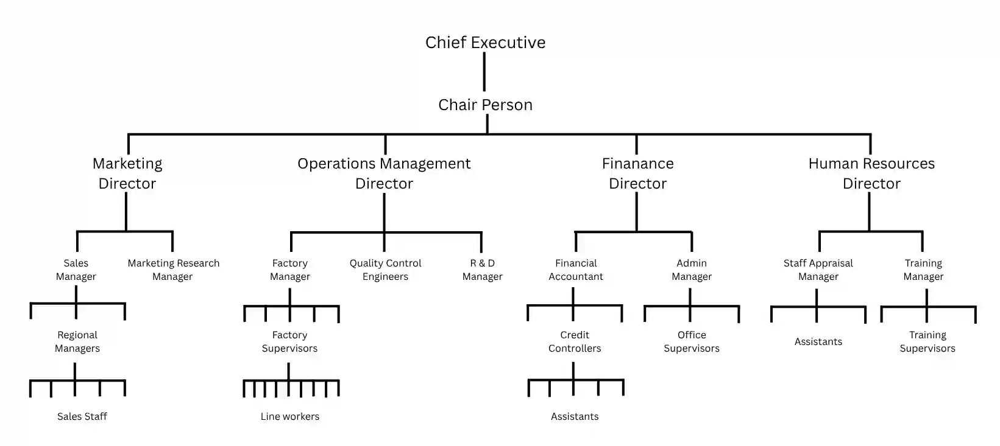
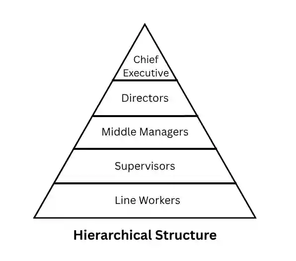
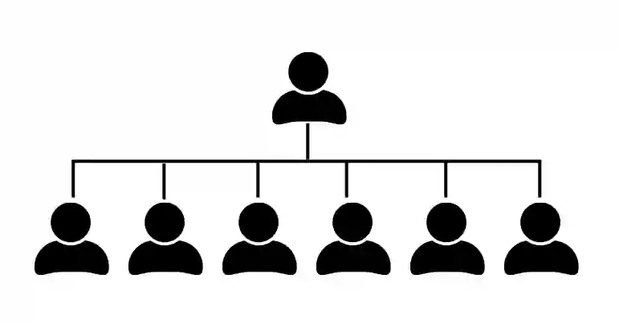
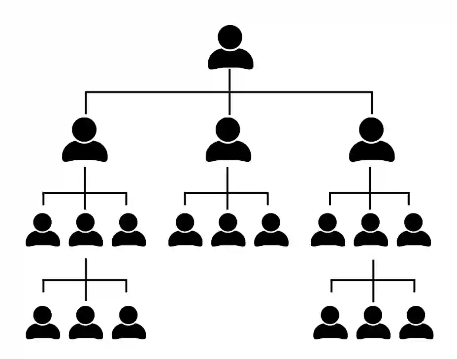
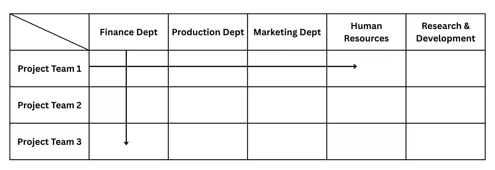

## **Types of structure**

### **Functional Structure:**

Departments that have defined roles and responsibilities in a specialist area such as marketing, finance, human resources or operations.

**Visual Example of a Functional Structure:**

**The structure above indicates:**

* Who has overall responsibility for decision-making.

* The formal relationships between different people and departments.

* The position of each individual in the business and who their line manager is.

* The way in which accountability and authority may be passed down the organization.

* The number of subordinates reporting to each more senior manager.

* Formal channels of communication, both vertical and horizontal.

* The identity of the supervisor or manager to whom each worker is accountable.

**Benefits & Limitations of Functional Structure:**

#|
||

Benefits of Functional Structure

|

Limitations of Functional Structure

||
||

Employees take pride in their department’s work.

|

Vertical structure restricts interdepartmental connections.

||
||

Encourages expertise, leading to higher productivity.

|

Difficulties arise in managing large projects involving multiple departments.

||
||

Departments are managed by specialists in their respective fields.

|

Employees may feel disconnected from senior management.

||
||

N/A

|

Departments may compete for resources, sometimes at the expense of overall business goals.

||
|#

**Functional Manager:**

A senior employee who has authority over a complete organisational unit.

### Hierarchical Structure

A structure consisting of multiple levels in which all members of the organisation, apart from one, are subordinate to someone else.

* **Level of Hierarchy:** a stage of the organisational structure where all personnel have equal status and authority.

**An example is the image below:**

**Pros & Cons of Hierarchical Structure:**

#|
||

Pros

|

Cons

||
||

Authority start at the top and can be delegated down the hierarchy.

|

Information typically flows from top to bottom, which can be inefficient.

||
||

Each individual’s role is well-structured and clearly outlined.

|

Departments and divisions often operate in isolation, reducing collaboration.

||
||

A well-established authority structure ensures clear leadership.

|

Managers may focus only on their own department, leading to a narrow vision.

||
||

Commonly used in role-based cultures where job importance determines hierarchy.

|

The inflexible structure makes it difficult to adapt to changes.

||
||

It provides clear career growth opportunities for ambitious employees.

|

Managers may resist change to protect their position and department’s importance.

||
|#

**Chain of Command:**

* This is the route through which authority from the chief executive and the board of directors is passed down through an organisation.

**Span of Control:**

* The number of subordinate employees directly accountable to a manager.

There are two types of span of control:

1\. **Wide span of Control:**

**Pros & Cons of Wide Span of Control:**

#|
||

Pros

|

Cons

||
||

Fewer managers are needed, reducing salary and overhead expenses.

|

Supervising more employees can lead to stress and reduced effectiveness for managers, affecting their productivity.

||
||

Less hierarchy means quicker communication and decision-making process.

|

Employees may receive less guidance and support from managers.

||
||

Workers have more responsibility, leading to higher motivation and job satisfaction.

|

Managers may struggle to monitor and ensure consistent performance.

||
||

Fewer layers of management reduce the risk of message distortion, increasing effectiveness of communication.

|

With many employees per manager, instructions may be unclear or misinterpreted or might require longer detailed explanation for understanding.

||
||

Organizations have higher flexibility, thus can adapt quickly to changes as decision-making is decentralized.

|

Less time for coaching and mentorship may hinder employee growth; less ideal for self-actualization need-based workers.

||
|#

**2. Narrow Span of Control:**

**Pros & Cons of Narrow Span of Control:**

#|
||

Pros

|

Cons

||
||

Managers can closely monitor and guide employees, ensuring high-quality work.

|

More managers are needed, increasing salary and administrative expenses. It raises cost for the firm.

||
||

Fewer employees per manager lead to clearer and more effective communication.

|

A taller hierarchy can lead to delays in approvals and communication; it can be catastrophic during emergency.

||
||

More time for training, coaching, delegation, and mentorship helps employees grow. It might fulfill esteem needs as well as self-actualization.

|

Employees may feel micromanaged, leading to lower motivation and job satisfaction. It worsens productivity.

||
||

Managers can maintain tighter control over work processes and performance.

|

A rigid structure may make it harder for the organization to adapt to changes, hindering flexibility.

||
||

With fewer employees to oversee, managers can make well-informed decisions, affecting the firm positively.

|

More management layers can lead to inefficiencies and slow down processes.

||
||

Delegation taking place might increase motivation, employee loyalty and innovation within business.

|

N/A

||
|#

### **Divisional Organizational Structure**

A divisional organizational structure is a way of organizing a business based on either product lines or geographical regions. This structure allows each division to function independently while key strategic decisions remain centralized.

### **Structure by Product:**

The company is divided into product-based divisions. Each division has its own marketing, production, and R&D teams and is managed separately.

**Examples:**

* A steelmaking company with divisions for steel girders, steel sheets, and specialist steels.

* An IT hardware manufacturer with divisions for business computers, consumer electronics, laptops, and tablets.

**Pros & Cons of Product-Based Org Structure:**

#|
||

Pros

|

Cons

||
||

Focus on specific market segments.

|

Duplication of roles (e.g., separate sales teams in each division).

||
||

Faster response to consumer needs and market changes.

|

Risk of rivalry between divisions.

||
||

Easier to measure profitability and performance of each division.

|

Reduced central control over each division.

||
|#

### **Structure by Geographical Area**

This structure divides the company based on regions or countries, allowing each division to operate independently to cater to local markets.

**Examples:**

* A global fast-food chain with divisions in North America, Europe, and Asia.

* A multinational retail company with separate operations in different continents.

**Pros & Cons of Geographical Org. Structure:**

#|
||

Pros

|

Cons

||
||

Better adaptation to local market needs and cultures.

|

Duplication of roles in different regions.

||
||

More effective decision-making within each region.

|

Risk of inconsistency in branding and operations.

||
||

Closer customer relationships due to localized management.

|

Higher operational costs due to separate regional teams.

||
|#

### **Delayering**

Delayering refers to the removal of one or more levels of hierarchy in an organizational structure. This often results in a flatter structure with fewer layers of management.

**Why Businesses Use Delayering:**

* **Advancements in IT & Communication Technology:** Senior managers can now directly monitor and communicate with junior employees, reducing the need for middle managers.

* **Cost Reduction:** Cutting middle management lowers salary expenses and overhead costs.

* **Faster Decision-Making:** Fewer layers mean quicker communication and decision-making.

* **Empowerment of Employees:** With fewer managerial levels, employees take on more responsibility and decision-making power.

**Pros & Cons of Delayering:**

#|
||

Pros

|

Cons

||
||

Delayering reduces business costs.

|

There could be one-off costs of making managers redundant (e.g. redundancy payments).

||
||

It shortens the chain of command and should improve communication through the organisation.

|

Managers who remain have increased workloads, which could lead to overwork and stress.

||
||

It increases spans of control and opportunities for delegation.

|

Fear that redundancies might be used to cut costs could reduce the sense of security of the whole workforce (one of Maslow's needs).

||
||

It may increase workforce motivation due to less remoteness from top management and greater chance of having more responsible work to perform.

|

Cutting middle managers may lead to a loss of valuable skills and leadership.

||
|#

### **Matrix Structure**

The matrix structure is a flexible organizational structure designed to overcome the limitations of a traditional hierarchy. It focuses on projects or tasks, assembling teams with specialists from different departments or divisions. Instead of emphasizing hierarchy, it prioritizes collaboration and expertise.

**Visual Example of Matrix Structure:**

**Key Features Of Matrix Structure:**

* ### Employees work in cross-functional teams rather than rigid departmental silos.

* Individuals report to more than one manager (e.g., a functional manager and a project manager).

* Focus is on task completion rather than job title or hierarchy.

* Encourages collaboration between different departments like marketing, finance, and production.

**Example:**

* A car company developing a new electric vehicle may form a project team with engineers, designers, marketers, and financial analysts from different departments.

**Benefits and Drawbacks  of Matrix Structure:**

#|
||

Benefits

|

Drawbacks

||
||

It allows good communication between all members of the team.

|

There is less direct control from senior managers as the teams may be empowered to undertake and complete a project.

||
||

It cuts across traditional boundaries between departments in a hierarchy.

|

Reduced bureaucratic control may be resisted by some senior managers.

||
||

There is less chance of people focusing on just what is good for their department as the aim is to focus on the project and the business as a whole.

|

Passing down of authority to more junior employees can be difficult for some senior managers to accept.

||
||

Crossover of ideas between people with specialist knowledge in different areas tends to create more successful and innovative solutions.

|

Team members may have two managers, leading to potential conflicts. If a business keeps department hierarchies but forms cross-department teams, employees must report to both, which may create issues.

||
||

New project teams can be created quickly so this system is well-designed to respond to changing markets or technological innovations.

|

N/A

||
|#

