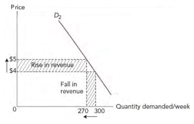
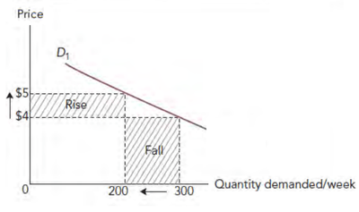

# Marketing Analysis

## Elasticity

### **Elasticity of demand**

* Marketing decisions on pricing, products, promotions, and distribution should use up-to-date, relevant information. **For example, marketing managers benefit from knowing:**

  * How will a 10% price increase affect demand?
  * How will sales change with a 1 million dollar boost in promotions?
  * How will consumer income changes impact product demand?

* Marketing departments assess how price, promotions, and consumer income affect demand. **Elasticity of demand measures this impact.**

### **Price elasticity of demand**

* The diagrams below show that curve **D2–D2** is steeper than **D1–D1**.

* A steeper curve means less change in demand when prices rise.

* When both products’ prices increase equally, demand for product B drops more than for product A.

* Product A’s total revenue increases, while product B’s falls, as shown by the shaded areas.

* This relationship between price changes and the proportion of the resulting change in demand is known as price elasticity of demand (PED).

* Demand curves show this concept. Product A’s demand is less elastic, or responsive, to price changes than product B’s. This can also be measured mathematically.

  * **PED =** Percentage change in Quantity Demanded ​/ Percentage change in Price

### **Interpreting price elasticity results**

* PED results should be interpreted carefully.

#|
||

Value of PED (ignoring minus sign)

|

Classification

|

Explanation

||
||

Zero

|

Perfectly inelastic demand

|

Demand stays the same at any price. No product has this PED in reality.

||
||

Between 0 and 1

|

Inelastic demand

|

Demand changes less than price. With this PED, higher prices increase revenue, but further increases make demand more elastic.

||
||

Unitary

|

Unit elasticity

|

When PED = 1, demand changes equally with price, keeping revenue constant. Sales revenue is maximized at this point.

||
||

Between 1 and infinity (∞)

|

Elastic demand

|

When demand changes more than price, lowering price increases demand and revenue.

||
||

Infinity (∞)

|

Perfectly elastic demand

|

At one price, demand is infinite but drops to zero with any price increase. No product has this PED in reality.

||
|#

* Price elasticity of demand (PED) is usually negative due to the inverse relationship between price and demand. A price drop increases demand, while a price rise decreases it. The negative sign is often ignored, focusing instead on the numerical value.

* **Example:** In Figure 21.2, price rose from 4 to 5 dollars, reducing demand from 300 to 270 units. Calculate the PED.

  * **step 1:** calculate percentage change in price
  * **step 2:** calculate percentage change in demand
  * **step 3:** use the formula
    * % change in demand = 10
    * % change in price = 25
    * **PED = $\frac{\text{10}}{\text{25}}$ = 0.4 (remember, this result is negative)**

* A PED of 0.4 means demand changes by 0.4% for every 1% change in price. Since this is less than one, demand is inelastic. Consumers respond minimally to price changes.

* A price increase raises revenue, while a decrease lowers it due to little change in demand.

### **Factors that determine price elasticity of demand**

* **Factors Affecting PED:**

  * **Necessity:** Essential products like salt have inelastic demand as consumers react less to price changes.

  * **Competitors:** More substitutes make demand elastic, while fewer competitors reduce elasticity.

  * **Loyalty:** Strong brands (e.g., Coca-Cola) maintain demand despite price rises, driven by advertising and product differentiation.

  * **Income Proportion:** Low-cost items (e.g., matches) have inelastic demand since price changes minimally impact budgets.

### **Impact of price elasticity of demand on business decisions**

* **Impact of PED on Business Decisions:**

  * **Pricing:** Raise prices on routes with low PED and lower them on routes with high PED to boost revenue. Supports price discrimination strategies.

  * **Wages:** Wage increases are more feasible if PED is low, as higher prices won’t significantly reduce demand. High PED makes passing wage costs to consumers harder.

---

### **Income elasticity of demand**

* Elasticity applies to variables beyond price. When consumer income changes, demand usually rises. Income elasticity of demand measures how much it changes.

  * **Income elasticity = Percentage change in demand for the product​ / Percentage change in consumer incomes**

* Example: After a 5% income drop, demand for own-label cereal rose 10%, branded cereal fell 10%, and salt declined 1%. Verify these income elasticity results in the table below.

#|
||

Own-label cereal

|

Branded Cereal

|

Salt

|

||
||

Income elasticity of demand

|

-2

|

2

|

0\.2

||
|#

### **Interpreting income elasticity results**

* The own-label cereal is an inferior good with a superior branded alternative. Demand rises as income falls and falls as income rises. Income elasticity is negative and should always show the negative sign.

* The branded product is a normal good with positive income elasticity. Demand rises with income and falls when income drops. If income elasticity exceeds 1, the product is a luxury good with inferior substitutes. Demand changes more than income.

* Salt is a necessity with low positive income elasticity. Demand is income inelastic, remaining stable regardless of income changes.

### **Impact of income elasticity on business decisions**

* **Income elasticity influences business decisions in two ways:**

  * In economic growth, businesses increase output of income-elastic products like luxury goods. New products should have high income elasticity.

  * In a recession, businesses focus on basic, lower-priced products. Firms selling inferior goods may boost output to meet rising demand. New products should be affordable, not exclusive or costly.

---

### **Promotional elasticity of demand**

* Promotional elasticity of demand is measured by:

  * Promotional elasticity  = $\frac{\text{Percentage change in demand for the product}}{\text{Percentage change in promotional spending}}$

* **Increased promotion usually raises demand, resulting in positive promotional elasticity.**

  * If above 1 (like product B), demand rises more than promotional spending, showing elastic demand.

  * If below 1 (like product A), demand is inelastic. Rarely, promotional elasticity can be negative if campaigns offend consumers, causing demand to drop.

### **Interpreting promotional elasticity of demand**

* Increased promotion typically boosts demand, **making promotional elasticity positive.**

* If the result **exceeds 1**, demand rises more than promotion spending **(elastic)**.

* If **below 1**, demand rises less **(inelastic)**.

* Rarely, promotional elasticity **may be negative if offensive campaigns reduce demand.**

### **Impact of promotional elasticity on business decisions**

* Firms should **focus promotion** on products with **high promotional elasticity** and **reduce spending** on those with **low elasticity.**

* However, **low elasticity** may result from **ineffective campaigns** rather than the product itself.

* **Poorly designed promotions** targeting the **wrong audience can limit sales.**

* Before cutting promotion, firms should **investigate the cause of low elasticity**, as better campaigns could drive higher sales.

### **Limitations of the measures of elasticity**

* **Price elasticity of demand (PED) has three key limitations:**

  * **Assumes no other changes:** A price cut may boost sales, but factors like competitor exits or rising incomes can also influence demand, making accurate PED calculation difficult.

  * **Quickly outdated:** PED changes as consumer tastes shift and new competitors enter. Past calculations may no longer reflect current market conditions.

  * **Difficult to calculate:** PED often relies on old sales data or market research, which can be inaccurate, especially for new products.

* **Income elasticity:** Rising incomes may not boost demand if competitors launch better products.

* **Promotional elasticity:** Sales changes may stem from factors beyond the promotion, like competitor campaigns or economic shifts, making comparisons unreliable. Sales may have risen regardless of promotion due to favorable conditions.

* Despite this, consistent results can provide valuable insights for future marketing decisions.