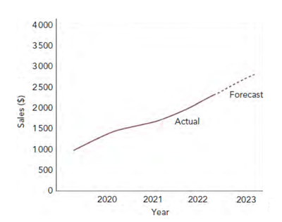
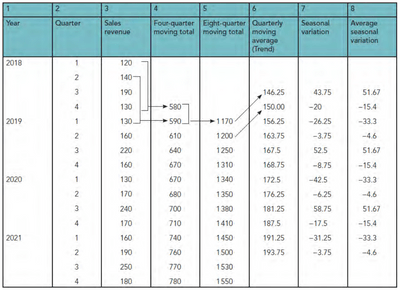
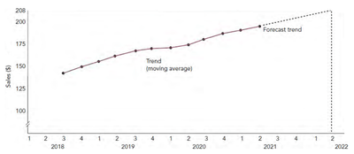

## Sales forecasting

* **Accurate sales forecasting reduces business risks, offering benefits like:**
  * Operations can plan production, materials, and inventory.
  * Marketing knows how many products to sell and distribute.
  * HR can plan workforce needs with the right skills.
  * Cash flow forecasting becomes more reliable.
* **However**, 100% accuracy is impossible due to external factors like economic changes, competitor actions, and pricing adjustments.
* Most businesses use sales forecasts to minimize uncertainty in future demand.

### **The need to forecast sales**

* **Sales forecasts are crucial for:**

  * Market planning and new product screening.

  * Planning workforce needs.

  * Preparing resources like materials and equipment.

  * Predicting capacity requirements for operations.

  * Informing decisions on price changes and promotions, especially if demand is expected to decline.

---

### **Time series analysis**

* This sales forecasting method relies on past sales data organized chronologically as a time series.

### **Extrapolation**

* Extrapolation predicts future sales by extending past trends on a time series graph.

* This method assumes stable sales patterns, making it unreliable when conditions change.

### **Moving averages**

* **This method is more advanced than graphical extrapolation, identifying factors expected to impact future sales, such as:**

  * The trend

  * Seasonal fluctuations

  * Cyclical fluctuations

  * Random fluctations

* Most questions on this topic focus on identifying trends and seasonal fluctuations.

* The moving average method in Table 1 analyzes these factors for ice cream sales, enabling short-term forecasts.

* **Points to note**

  * The moving average method calculates totals from several sales figures. In Table 2, each total in column 4 represents four quarters, forming a four-quarter moving total. This duration was chosen due to consistent variation over four quarters, such as peak ice cream sales in summer. For daily data, a seven-period total might apply, reflecting weekly variations, while monthly data might use a twelve-period total.

  * Dividing the four-quarter moving total by 4 yields an average that doesn't align with any specific quarter (see Table 1). To fix this, two four-quarter totals are added to form an eight-quarter total (column 5, Table 2), which is then divided by 8 to produce the quarterly moving average (column 6).

  * The quarterly moving average represents the trend, smoothing seasonal fluctuations to reveal the data's underlying movement.

  * Seasonal fluctuations can then be calculated as the difference between actual sales and the trend, as shown in Table 2.

* Seasonal variation (column 7) = actual result (sales revenue, column 3) – moving average trend (column

* **Ensure the correct sign for your results.** A negative value indicates that quarterly sales are typically below the trend due to seasonal factors.

  * The **average seasonal variation (ASV)** is found by adding the seasonal variations for each quarter and dividing by the number of results.

    * 43.75 + 52.5 + 58.75 = 155

  * The average seasonal variation for Q3 = **155/3 = ASV 51.67.**

|**Quarter**|**Sales**|**Four-quarter total**|**Four-quarter average**|
|:---|:---|:---|:---|
|1|20|||
|2|30||27.5|
|3|50|||
|4|10|110/4||

**Table 1**

### **Forecasting using the moving average method**

* **The results from Table 2 enable short-term forecasting:**

  * Plot the moving average trend on a time series graph (Table below).

  * Extrapolate the trend for future periods, as short-term projections are more accurate.

  * Read the forecast trend from the graph for the target period (e.g., quarter 2, 2022).

  * Adjust the forecast using the average seasonal variation for that period.

* For quarter 2 in 2022, the forecast equals the extrapolated trend forecast plus the average seasonal variation.

  * **208 000 + (– $4 600) = 203 400**

### **An evaluation of the moving average method**

#|
||

Benefits

|

Limitations

||
||

Identifies seasonal variations for predictions.

|

Long-term forecasts are less accurate as they rely solely on past data, which may not reflect future changes.

||
||

Accurate for short-term forecasts in stable conditions.

|

The moving average method ignores qualitative factors, requiring alternative methods for longer-term forecasts.

||
||

Highlights average seasonal variations to aid future quarter planning.

|

- 

||
|#

### **Qualitative sales forecasting methods**

### **Sales force composite**

* Sales representatives maintain contact with retail customers, gaining insight into market trends and demand. Sales forecasts are created by compiling individual estimates from the sales team.

* The **sales force composite method** is quick and inexpensive but may overlook macroeconomic factors and competitor actions. Customers might overestimate future sales to secure better deals.

### **Delphi method**

* The **Delphi method** gathers expert opinions through anonymous questionnaires on future events like demand or technology changes.

* After each round, responses are summarised and shared with the panel, prompting further input.

* This process continues until a consensus is reached, refining extreme views.

* The method, named after **the Oracle of Delphi**, is more accurate than unstructured expert discussions.

### **Jury of experts**

* The jury of experts uses senior managers to develop forecasts based on their expertise.

* It is quicker and cheaper than the Delphi method but lacks external insights into market conditions and consumer trends.

### **The impact of sales forecasting on business decisions**

* Sales forecasting helps businesses make informed decisions and growth plans.

* Accurate forecasts improve decisions across all functions.

* **For example, if forecasts show declining sales, business can make the following decisions:**

  * **Marketing** – Lower prices, boost promotions, expand distribution, develop new products, or enter stronger markets.

  * **Operations** – Avoid excess capacity, minimize inventory, or ensure flexibility to shift products.

  * **Finance** – Secure short-term funds, cut costs, or seek long-term finance for new products.

  * **HR** – Plan flexible contracts, reduce hiring, or prepare for redundancies.

* Sales forecasts should not be the sole basis for decisions **due to their limitations**.

* However, sharp sales shifts **highlight the value of a flexible, adaptable organization capable of quick decisions.**