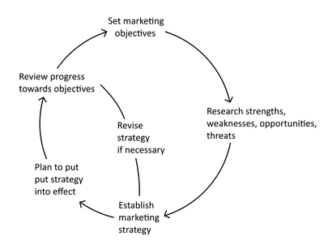

# Marketing Strategy

## Planning the Marketing Strategy

### Contents of a marketing plan

* Developing a marketing strategy is called marketing planning

* **A typical marketing plan includes:**

  * Purpose and business mission

  * Situational analysis (current state, including market research)

  * Marketing objectives (goals for the strategy)

  * Marketing strategy (action plan to achieve objectives)

  * Marketing mix (4Ps combination)

  * Marketing budget (available resources)

  * Executive summary and implementation timeline

### **Purpose and mission**

* This section outlines the plan's purpose, such as supporting a new business proposal or a product launch.

* The mission statement and background details clarify how the plan aligns with the business.

### **Situational analysis and market research**

* **Understanding the business's current position is crucial for effective marketing strategies. This involves:**

  * Current product portfolio

  * Target market research (e.g., consumer profiles)

  * Competitor analysis (e.g., number and marketing mix)

  * Economic and political factors (PEST analysis)

  * SWOT analysis

### **Marketing objectives**

* **A marketing plan should answer: Where do we want to be? Clear, SMART marketing objectives help track progress. Objectives may include:**

  * Sales targets (units or dollars) by a set date

  * Market share goals

  * Sales growth rate

  * Profit margin targets for the product

### **Marketing strategy**

* **This section explains how the business will achieve its marketing objectives, such as:**

  * Mass or niche marketing.

  * Targeting existing markets and consumers.

  * Entering new market segments.

  * Expanding into new markets (e.g., internationally).

### **Marketing resources**

* Resources that can be used by a business in order to reach its marketing objectives

**They include:**

* **Website**

  * Acts as the digital storefront.

  * Should be clear, user-friendly, and informative.

* **Social Media**

  * Platforms like Instagram, Facebook, TikTok, LinkedIn

  * Used to promote, engage, and build brand awareness

* **Email Marketing**

  * Sends direct messages to subscribers

  * Useful for updates, offers, and building loyalty

* **Paid Advertising**

  * Includes Google Ads, Meta Ads, etc.

  * Targets audiences based on behavior or interests

### **Marketing mix**

* **The marketing plan outlines specific tactics within the 4Ps:**

  * **Product**: USP and key differentiator

  * **Price**: Skimming or penetration pricing

  * **Promotion**: Planned methods

  * **Place**: Main distribution channels

### **Marketing budget**

* The plan must align with the marketing budget, detailing monthly spending for each promotion method.

* Total costs should stay within the allocated budget for the product launch.

### **Reviewing the marketing plan**

* How successful was the marketing plan? Assess whether objectives were met and identify any shortfalls.

* Adjustments may be needed for the next period. Evaluate overall success at the end of the review period to refine the strategy.

* Strategic planning is an ongoing process known as the strategic planning cycle.

### **Benefits and limitations of marketing planning**

#|
||

Benefits

|

Limitations

||
||

It is essential to the overall business plan, demonstrating market potential, profitability, and appropriate marketing tactics.

|

It can be time-consuming, and small businesses may lack the expertise for an effective plan.

||
||

It reduces the risk of failure, as clear objectives, market research, coordinated strategy, and budget control minimize risks.

|

In fast-changing markets, inflexible plans may be disadvantageous, especially with new competitors.

||
||

It provides direction for other departments like finance, operations, and HR.

|

Inadequate market research can lead to inappropriate strategies.

||
|#

