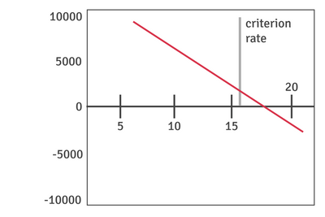

## Discounted cash flow method: Net Present Value (NPV)

* Managers may struggle to choose between projects if the two methods give conflicting results.
* Managers need a method that accounts for both cash flow size and timing. This can be achieved through discounted cash flow calculations.
* Ignoring inflation, a rational person would prefer **1,000 dollars** today over **1,000 dollars** in a year.
* **Today’s payment is preferred for three reasons:**
  * It can be spent immediately, providing benefits instantly.
  * Saving it at the current interest rate results in more than $1,000 in a year.
  * Cash today is certain, while future payments are uncertain.
* **Discounting adjusts future cash flows to their value in today’s terms, based on the interest rate**
  * If **1,000 dollars** today grows to **1,100 dollars** in a year at *10% interest*, then **1,100 dollars** in one year is worth the same as **1,000 dollars** today. **This is called the present-day value of future cash.**
* Discounting allows comparison for investment projects by considering the present value of their returns.

### **Discounting: How is it done?**

* **The present-day value of a future sum depends on two factors:**
  * Higher interest rates reduce the value of future cash.
  * The longer the wait, the lower the value of future cash today.
* Interest rates and time are used to calculate discount factors, which can be found in discount tables (table below). To find present-day values, multiply the appropriate discount factor by the future cash flow.

|**Year**|**6%**|**8%**|**10%**|**12%**|**16%**|**20%**|
|:---|:---|:---|:---|:---|:---|:---|
|1|0.94|0.93|0.91|0.89|0.86|0.83|
|2|0.89|0.86|0.83|0.79|0.74|0.58|
|3|0.84|0.79|0.75|0.71|0.64|0.58|
|4|0.79|0.74|0.68|0.64|0.55|0.48|
|5|0.75|0.68|0.62|0.57|0.48|0.40|
|6|0.71|0.63|0.56|0.51|0.41|0.33|

* For example, **3,000 dollars** is expected in three years at a 10% interest rate. The discount factor for Year 3 is 0.75, meaning **1 dollar** in three years is worth **75 cents** today. Multiplying **3,000 dollars** by the discount factor gives a present-day value of **2,250 dollars**.

### **The meaning, calculation, and interpretation of Net Present Value (NPV)**

* **This investment appraisal method uses discounted cash flows. NPV is calculated by subtracting the capital cost from the total discounted cash flows. The three stages are:**
  * Multiply net cash flows by discount factors (cash flows in year 0 are not
  * discounted).
  * Add the discounted cash flows.
    Subtract the capital cost to find the NPV.

|**Year**|**Net cash flow**|**Discount factors @ 8%**|**Discounted cash flows**|
|:---|:---|:---|:---|
|0|($10000)|1|($10000)|
|1|$5000|0.93|$4650|
|2|$4000|0.86|$3440|
|3|$3000|0.79|$2370|
|4|$2000|0.74|$1480|

* The working is shown in the table above. The initial cost is paid in year 0 and is not discounted. NPV is calculated as:
  * Total discounted cash flows = $11940
  * Original investment = ($10 000)
  * Net present value = $1940
* The NPV of **1,940 dollars** means the project earns that amount in today’s money values. If the finance can be borrowed at an interest rate under 8%, the investment will be profitable. Raising the discount rate reduces the NPV, as future cash flows are worth less when discounted at a higher rate. The discount rate choice is crucial for project assessment.
* Typically, businesses choose a discount rate reflecting the cost of borrowing. Even with internal finance, the interest rate should be used due to the opportunity cost of not earning interest. Alternatively, a business may use a cut-off or criterion rate to decide if the NPV is positive and the investment is viable.

#### **Evaluation of the NPV**

|**Advantages of NPV**|**Disadvantages of NPV**|
|:---|:---|
|Considers both the timing and size of cash flows|Complex to calculate and explain, especially for non-numerate managers|
|Discount rate can be adjusted for changing economic conditions, such as rising interest rates|Result depends on the discount rate used, and interest rate expectations can be inaccurate|
|Accounts for the time value of money and the opportunity cost of money|NPVs can be compared only if projects have the same initial capital cost, as the method does not provide a rate of return|
