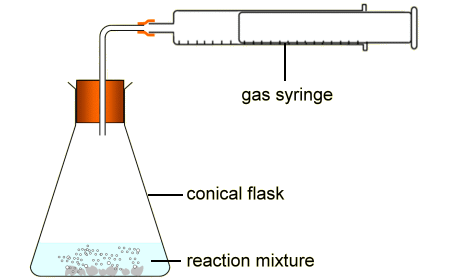

## Measuring Gas using a Gas Syringe

  - Take the initial reading of the gas syringe

  - Carry out procedure e.g. heating a solid or adding a reagent

  - Take the final reading of the gas syringe when the volume is
    constant or take readings at regular time intervals

  - If the experiment involves heating a reagent, wait until gas is at
    room temperature before measuring the volume

  - Calculate the maximum mass of solid/reagent that can be used by
    equating volume produced to the volume of the gas syringe used. Use
    samples smaller in size than that.
