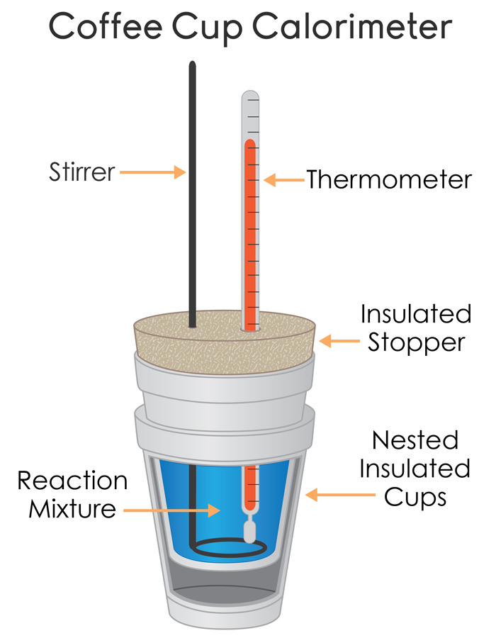
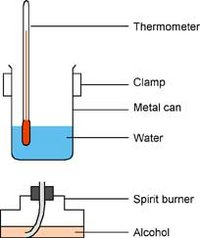

## Measuring Enthalpy Experiments

**Measuring enthalpy change of an experiment with a solid and a liquid
or two liquids:**

  - Measure the specific mass of solid to add using a balance

(mass of bottle + solid) – (mass of bottle + residue)

  - Measure the specific volume of reagent to add using a
    burette/pipette

  - Measure initial temperature of the reaction mixture

  - Record the highest temperature

  - Calculate enthalpy using $E = - mc\mathrm{\Delta}T$

&nbsp;

**Disadvantages of using plastic cup to measure enthalpy changes and
improvements:**

  - Heat loss to the surroundings from the beaker:
    
      - Cover the plastic cup with a lid
    
      - Place cup in a beaker; air acts a good insulator
    
      - Use multiple cups to thicken the lateral layer of plastic

  - Instability of the cup
    
      - Place the cup in a glass beaker

  - For exothermic reactions, solution likely to spray
    
      - Use a larger beaker/cup to carry out the experiment
    
      - Put a lid on top of the beaker to minimize the spray

&nbsp;

**Measuring enthalpy change of combustion**

‎

  - Measure mass of spirit burner using a 2 d.p. balance

  - Add specific volume of water into a metal can using a measuring
    cylinder

  - Take the initial reading of water using a thermometer
    (1oC)

  - Light spirit burner and burn for a specific length of time

  - Take the final reading of water after a specific time

  - Measure the mass of spirit burner after burning

  - Calculate the mass of alcohol burned

  - Use $E = - mc\mathrm{\Delta}T$ and use ratios to calculate for 1
    mole of alcohol
