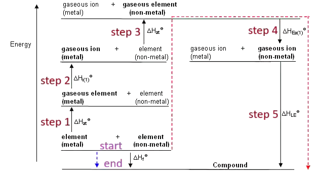

## Born-Haber Cycle (as an energy level diagram)

* Note: $\mathrm{\Delta}H_{f}^{\ominus}$ of an element under standard
  conditions = 0

**Endothermic Processes:**

*These processes are represented as upward-facing arrows:*

$$
\mathrm{\Delta}H_{i}^{\ominus}
$$

$$
\mathrm{\Delta}H_{\text{at}}^{\ominus}
$$

$$
\mathrm{\Delta}H_{\text{ea}}^{\ominus}\ \text{2}^\text{nd}\ \text{and} \ \text{3}^\text{rd}
$$

**Exothermic Processes:**

*These are displayed as downwards arrows:*

$$
\mathrm{\Delta}H_{f}^{\ominus}
$$

$$
\mathrm{\Delta}H_{\text{ea}}^{\ominus}
$$

$$
\mathrm{\Delta}H_{\text{latt}}^{\ominus}
$$

$$
\mathrm{\Delta}H_{\text{hyd}}^{\ominus}
$$

* Note: When constructing Born-Haber cycles, the elements go near the bottom-left-hand side, and you must atomise and ionise the metal first, then the non-metal