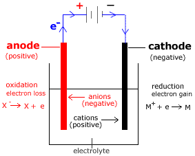

# Electrochemistry

## Electrolysis

* **Electrolysis:** Decomposition of a compound into its elements when molten or in aqueous solution by an electric current

**Electrolytic cell:**

‎ 

* **Electrolyte:** Compound that is decomposed (molten/ionic). Mostly ionic compounds.
* **Electrodes:** Rods which allow current to enter or leave the electrolyte (inert/reactive)
* Note: In simple electrochemical cells, electricity is generated from a spontaneous reaction, while in electrolytic cells, electricity is needed for a non-spontaneous reaction to occur