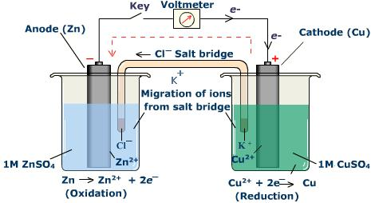
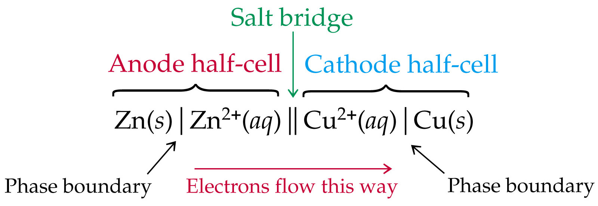
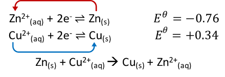

## Electrochemical Cell

<table border> <thead> <tr class="header"> <th colspan=2>‎</th> </tr> </thead> <tbody> <tr class="odd"> <td>

ANODE

 
<em>-ve electrode/half cell</em>
</td> <td>

CATHODE

 
<em>+ve electrode/half cell</em>
</td> </tr> <tr class="even"> <td><em>Eθ</em> of half-cell is more -ve (less +ve)</td> <td><em>Eθ </em>of half-cell is more +ve (less -ve)</td> </tr> <tr class="odd"> <td>Metal loses e-, forms +ve ions = oxidation occurs</td> <td>Metal ion gains e-, solid metal deposited = reduction occurs</td> </tr> <tr class="even"> <td colspan=2>
Cell Notation
</td> </tr> <tr class="odd"> <td>Zn(s) | Zn2+(aq)</td> <td>Cu2+(aq) | Cu(s)</td> </tr> <tr class="even"> <td colspan=2></td> </tr> <tr class="odd"> <td>The more –ve (less +ve) the <em>Eθ</em>, the more easily it gets oxidized ∴ stronger reducing agent</td> <td>The more +ve (less -ve) the <em>Eθ</em>, the more easily it gets reduced ‎∴‎ stronger oxidizing agent</td> </tr> <tr class="even"> <td colspan=2></td> </tr> <tr class="odd"> <td colspan=2>

<em>Eθcell = EθRed - EθOx</em>
 
<em>Eθcell </em>‎= 0.34 - -0.76 = 1.10‎

</td> </tr> </tbody> </table>