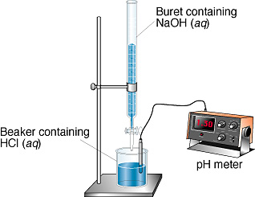

## Titration Curves

* **Titration:** method used to find conc. of a solution by gradually
  adding to it a second solution of known conc. until neutralization
  point is reached
* Progress of neutralization reaction monitored using a pH meter and
  shown on a graph
* **Equivalence point:** mid-point of near-vertical portion of the
  graph where no. of mols H+ = no. of mols OH-
* **End point:** volume of alkali/acid added when indicator just
  changes colour
* **Choosing a suitable indicator:**
  * Sharp colour change at end point
  * End point must be $\pm 2$ pH of equivalence point
  * Indicator should give distinct colour change

| Indicator | Colour at \n low pH | pH Range | Colour at \n high pH |
|----|----|----|----|
| Phenolphthalein | Colourless | 8.2 – 10.0 | Pink |
| Methyl orange | Red | 3.2 – 4.4 | Orange |

