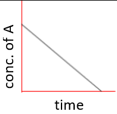
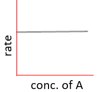
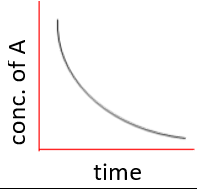
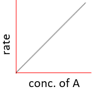
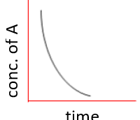
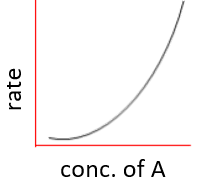
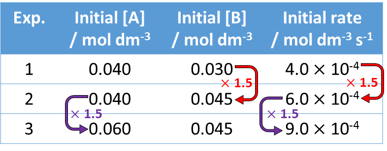

## Order of Reaction

| **Order** | **Half-life, t1/2** | **Graph of** |    |
|----|----|----|----|
|    |    | **Conc./Time** | **Rate/Conc.** |
| ‎ $\lbrack A\rbrack^{0}$ ‎ | Decreases | ‎   | ‎   |
| $\lbrack A\rbrack^{1}$ | Constant | ‎   | ‎   |
| $\lbrack A\rbrack^{2}$ ‎ | Increases | ‎   | ‎   |

* For zero order, rate of reaction not dependant on conc. of that
  reactant but it is need for completion of reaction. Reaction
  continues until all of that reactant is used up.
* Recognize shapes above in graphs given to work out order of reactant
  and construct rate equation. Calculate $k$ using data from
  graph(s).

**Constructing rate equation using conc. data:**

Using following data from the experiments construct a rate equation
and calculate rate constant.

**
Solution
**

*Use data and deduce orders by looking at changes in conc. and rates
(arrows added above):*

**
Order of A = 1 $\ \ \ \ \ \ \ \ \ \ \ \ \ \ \ \ \ \ \ \ \ \ \ \ \ $ Order of B = 1
**

*Write as rate equation*

$$
R = k\left\lbrack A \right\rbrack\lbrack B\rbrack
$$

*Calculate*\* $k$ \**using data given from e.g. experiment 1*

$$
k = \frac{R}{\left\lbrack A \right\rbrack\lbrack B\rbrack} = \frac{4.0 \times 10^{- 4}}{0.040 \times 0.030} = \frac{1}{3}
$$

$$
\therefore R = \frac{1}{3}\left\lbrack A \right\rbrack\left\lbrack B \right\rbrack
$$