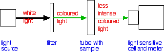

## Measuring Reaction Rates

**Sampling:** method that involves taking a small sample of a reaction mixture at various times and then carrying out chemical analysis on the sample.

**Chemical Analysis:**

$$
C_4H_9Br + OH^{-} \rightarrow
C_4H_9OH + Br^{-}
$$

* Sampled removed at various times and quenched – stopping/slowing
  down reaction (e.g. cooling in ice)
* OH- conc. can be found using titration
* Plot the graph and calculate the rate of reaction

**Continuous:** method that involves
monitoring a physical property over a period of time

**Change in Volume of Gas Produced:**

$$
Mg + 2HCl \rightarrow MgCl_2 + H_2
$$

* Measure the change in volume of gas using a gas syringe
* Take down readings at regular intervals
* Plot graph and calculate the rate of reaction

**Changes in Colour:**

$$
CH_3COCH_3 + I_2 \rightarrow
CH_3COCH_2I + HI
$$

* I$_2$ starts brown, fades through orange to yellow to
  colourless as iodine used up.
* The colourimeter measures the amount of light absorbed as it passes through the solution, recorded as absorbance.

‎ 

* Before the experiment, create a calibration curve by finding the absorbance of different conc. I$_2$ and plot a graph of concentration against absorbance
* During the experiment, measure absorbance from the meter at regular intervals, and use a calibration curve to convert values into concentrations