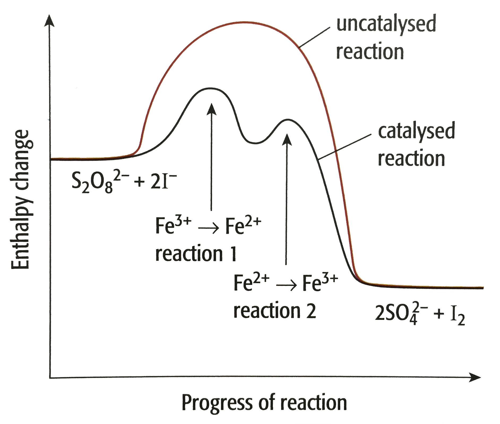
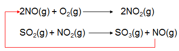

## Examples of Homogenous Catalysis

### **Iodine-Peroxydisulfate Reaction**

$S_2O_8\ ^{2-}+2I^{-}\xrightarrow{slow} 2SO_4\ ^2 +I_2$

* Mechanism of catalyst reaction:
  * Reaction 1: reduction of $Fe^3$ to $Fe^{2+}$ ions by $I^{-}$ ions

    $2I^{-} + 2Fe^{3+} \xrightarrow{Low\ Ea} I_2 + 2Fe^{2+}$
  * Reaction 2: oxidation of $Fe^{2+}$ to $Fe^{3+}$ ions by $S_2O_8\ ^{2-}$ ions

    $S_2O_8\ ^{2-}+2Fe^{2+} \xrightarrow{Lower\ Ea} 2SO_4\ ^{2-} + 2Fe^{3+}$

### **Oxides of Nitrogen and Acid Rain**

‎                   

* $SO_3$ can then react with water to form $H_2SO_4$

