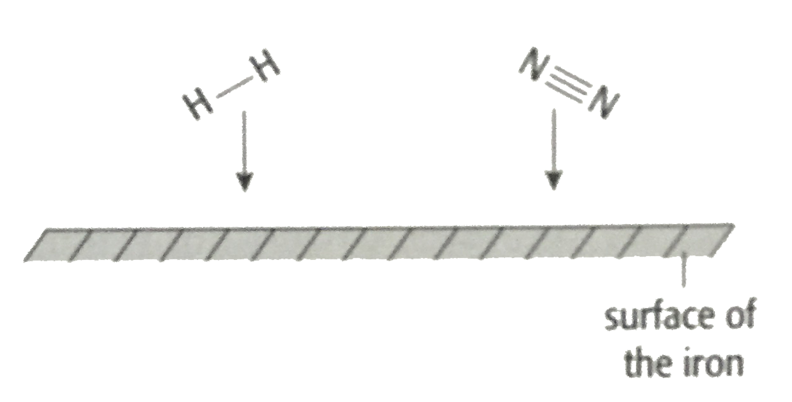
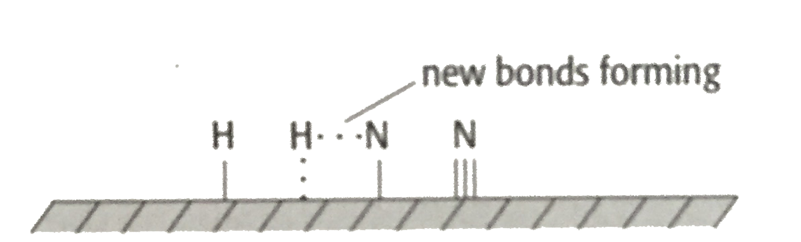
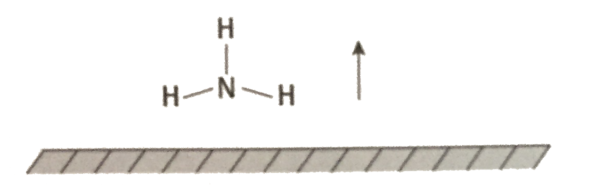

## Examples of Heterogeneous Catalysis 

**Iron in Haber process:**

$$
N_2+3H_2\xrightarrow{Fe}2NH_3
$$

<table>
<thead>
<tr>
<th>Diffusion of N2 and H2 to the surface of iron</th>
<th>‎</th>
</tr>
</thead>
<tbody>
<tr>
<td>Adsorption; bonds formed between reactant and iron: strong enough to weaken covalent bonds within N2/H2, weak enough to break and allow products to leave</td>
<td>‎</td>
</tr>
<tr>
<td>Reaction; adsorbed N and H atoms react to form NH3</td>
<td>‎</td>
</tr>
<tr>
<td>Desorption; bonds break between NH3 and surface</td>
<td>‎</td>
</tr>
<tr>
<td>Diffusion of NH3 away from surface of iron</td>
<td>‎</td>
</tr>
</tbody>
</table>png)

- Honeycomb structure containing small beads coated with Pt, Pd and Rh
- Possible catalytic process:

  - Adsorption of NO$_x$ and CO

  - Weakening of covalent bonds within NO$_x$ and CO

  - Formation of new bonds between

    - Adjacent N atoms form N$_2$

    - CO and O atoms form CO$_2$

  - Desorption of N$_2$ and CO$_2$