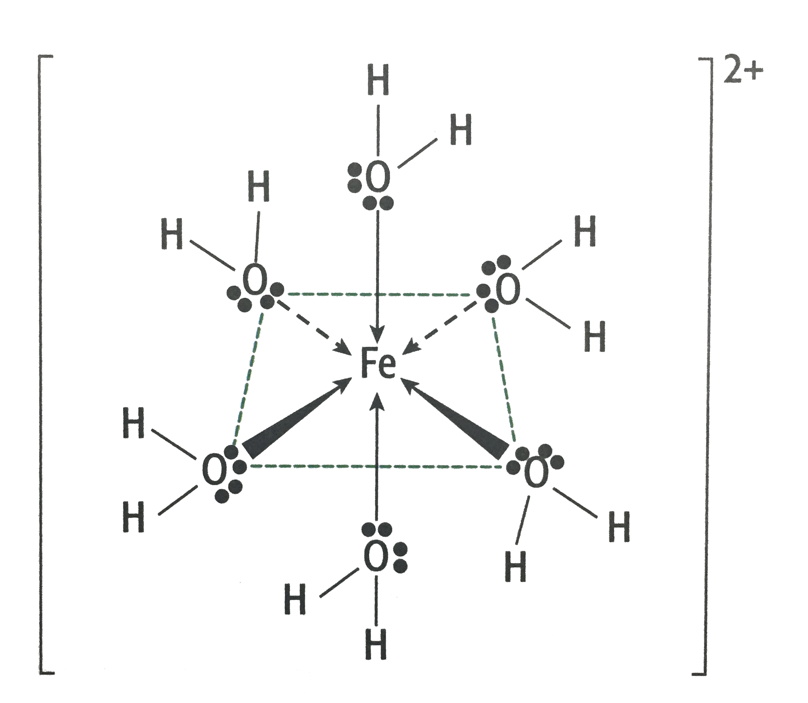
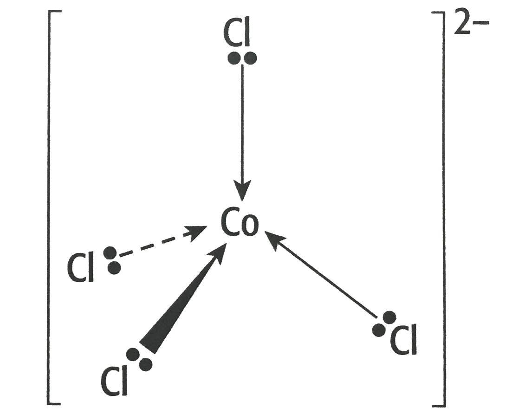
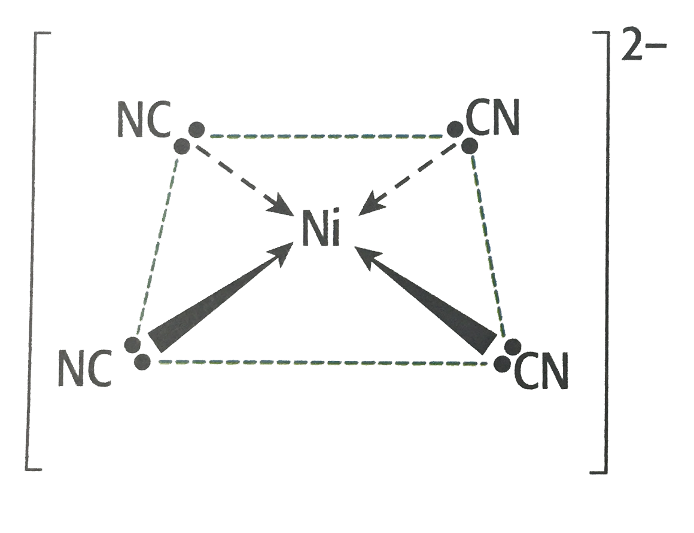
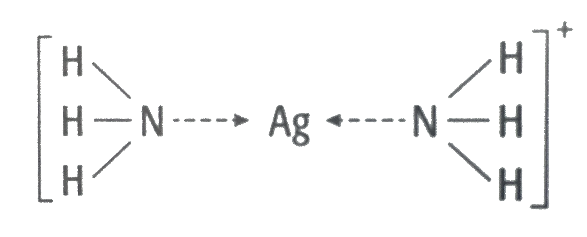

## Shapes of Complexes

<table border> <tr> <th>
Coordination No. & Shape
</th> <th>Diagram</th> </tr> <tr> <td>
6 Octahedral
</td> <td>  
<strong>\[Fe(H2O)6\]2+</strong>
</td> </tr> <tr> <td>
4 Tetrahedral
</td> <td>  
<strong>\[CoCl4\]2-</strong>
</td> </tr> <tr> <td>
4 Square Planar (most Ni and Pt)
</td> <td>  
<strong>\[Ni(CN)4\]2-
</td> </tr> <tr> <td>
2 Linear
</td> <td>  
<strong>\[Ag(NH3)2\]+</strong>
</td> </tr> </table>