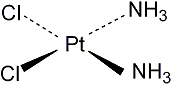
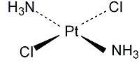
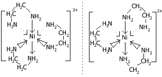

## Stereoisomerism

**Geometric isomerism (cis-trans)**

Pt(NH3)2Cl2

| ‎ | ‎ |
| ------------------------------------------------------------------- | ------------------------------------------------------------------- |
| cis-platin                                                          | trans-platin                                                        |

  - Cis-platin is an anticancer drug that acts by binding to DNA in
    cancer cells, preventing cell division

&nbsp;

**Optical isomerism**

$\lbrack Ni\left(NH_2CH_2CH_2NH_2 \right)_3\rbrack$

‎
