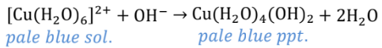
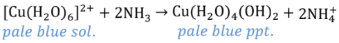
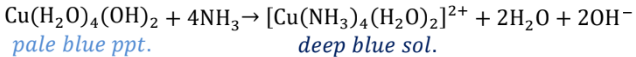
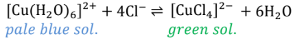

## Copper Chemistry

**Reaction with Hydroxide Ions**

  - Not ligand exchange; hydroxide ions remove hydrogen ions from water
    ligand

&nbsp;

**Reaction with Ammonia Solution**

*Small amount of ammonia*

  - Initially, ammonia acts as a base and hydrogen ions are pulled off
    the hexaaqua ion as above.

*Excess ammonia*

  - Ammonia replaces water as a ligand

  - Only 4 of the 6 water molecules replaced

&nbsp;

**Reaction with Chloride Ions**

  - 6 water molecules replaced by 4 chloride ions