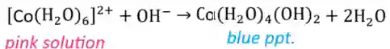
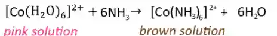
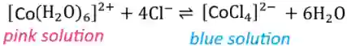

## Cobalt Chemistry

**Reaction with Hydroxide ions**

*Small amount of NaOH*

*Excess NaOH*

* If it is warmed as well, then the ppt will turn red

**Reaction with Ammonia Solution**

*Ammonia, added drop-by-drop*

* The brown Co (II) ion is oxidised by $O_{2}$ in the air to Co (III):  $[Co(NH_{3})_{6}]^{3+}$

**Reaction with Chloride ions** 

*Conc.* *HCl ,added drop-by-drop*

Note: Co (II) ions normally form tetrahedral complexes