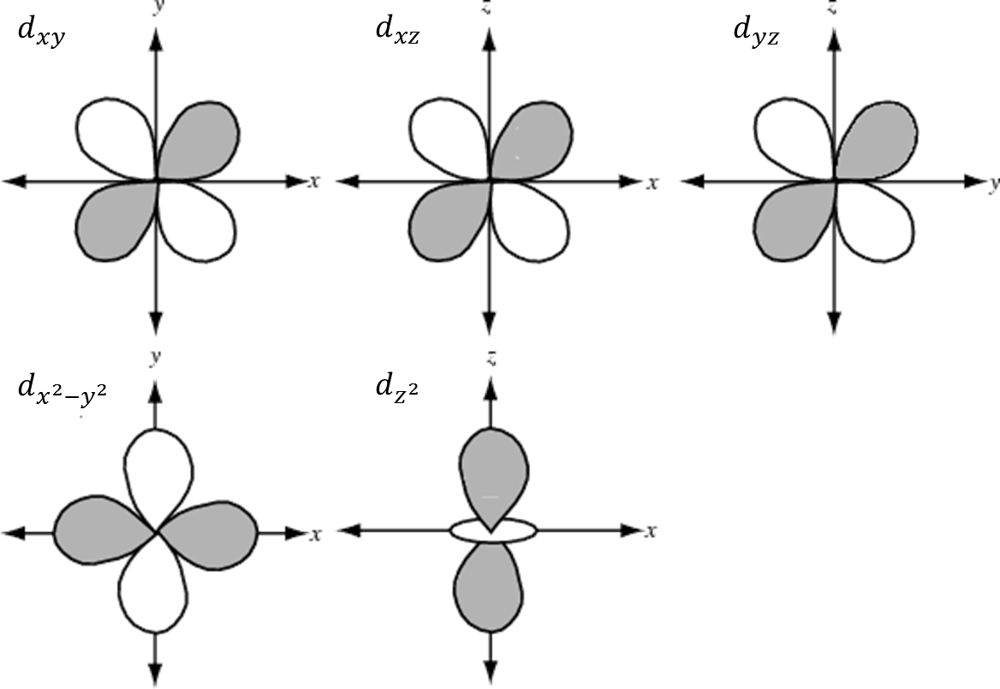

## d-Orbitals

‎

  - $d_{\text{xy}}$, $d_{\text{xz}}$ and $d_{\text{yz}}$ have
    d-orbitals in between axis

  - $d_{x^{2} - y^{2}}$ and $d_{z^{2}}$ have d-orbitals along
    axis

  - $d_{z^{2}}$ is formed by the merging of $d_{x^{2} - z^{2}}$
    and $d_{y^{2} - z^{2}}$
