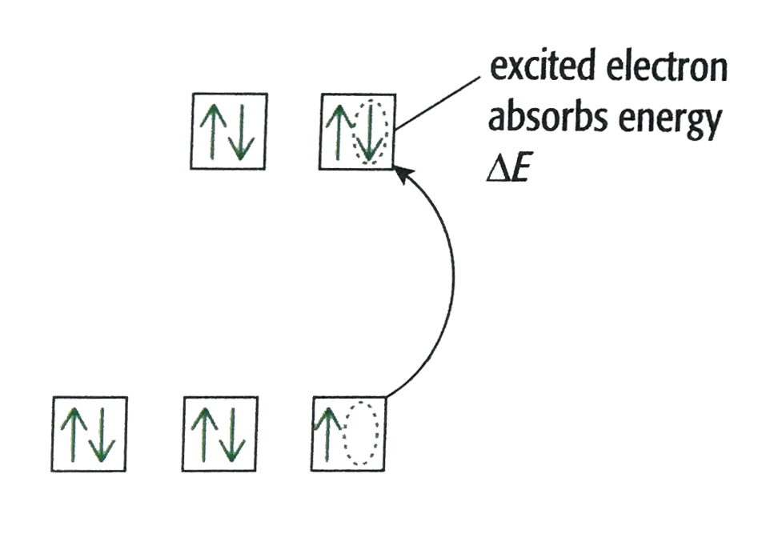

## Colours of Complexes

The five d-orbitals in isolated transition metal atoms/ions are
**degenerate** (all at the same energy level)

Co-ordinate bonding from ligands causes the five d-orbitals to split into
two sets of **non-degenerate** orbitals (where $\mathrm{\Delta}E$ is the
difference between the two energy levels)

* Non-degenerate orbitals are groups of orbitals within the same sub-shell with slightly different amounts of energy

  For octahedral complexes, ligands approach along axis and increases
  repulsion with $d_{x^2 - y^2}$ *and* $d_{z^2}$ orbital
  *causing them to be at a higher energy level than*

**e.g. an octahedral complex of Cu2+**

**Note:** in **tetrahedral** complexes, the $d_{x^2 - y^2}$ and $d_{z^2}$ orbitals lie *between*
the metal-ligand bonds

* Hence, there is less repulsion between electrons in either orbital and the electrons donated by the ligands

* Therefore, when these orbitals split, the $d_{x^2 - y^2}$ and $d_{z^2}$ orbitals are at a lower energy level than the $d_{yz}$, $d_{xz}$ and $d_{xy}$ orbitals

* Electrons from lower energy orbitals absorbed energy equal to
  $\mathrm{\Delta}E$ from light and are excited to a higher energy
  level orbital

* Wavelengths of light equivalent to $\mathrm{\Delta}E$ are absorbed
  and the rest are transmitted.
* Wavelengths transmitted merged together corresponds to the colour of
  the solution observed

  **Conditions for complex to be coloured:**
  * At least one d-orbital must be occupied by an e-
  * At least one d-orbital must not be fully occupied
* Hence, some compounds of d-block metals colourless:
  * **All Sc compounds are colourless because $\lbrack$Ar$\rbrack$ 3d0**
  * **All Zn compound are colourless because $\lbrack$Ar$\rbrack$ 3d10**

  **Factors that determine colour of complex (which affects the
  splitting of d-orbitals):**
  * Magnitude of $\mathrm{\Delta}E$
  * Strength of ligands
  * Oxidation state of metal ion
  * Geometry of complex

**Colour Spectrum**

<table>
<thead>
<tr>
<th bgcolor="red" style="color:white"><strong>R</strong></th>
<th bgcolor="orange" style="color:white"><strong>O</strong></th>
<th bgcolor="yellow" style="color:black"><strong>Y</strong></th>
<th bgcolor="green" style="color:white"><strong>G</strong></th>
<th bgcolor="blue" style="color:white"><strong>B</strong></th>
<th bgcolor="indigo" style="color:white"><strong>I</strong></th>
<th bgcolor="violet" style="color:white"><strong>V</strong></th>
</tr>
</thead>
</tbody>
</table>

* From left to right, the wavelength is **decreasing**
* From left to right, frequency is **increasing,** so $\mathrm{\Delta}E$ is also increasing, as:
  * $\mathrm{\Delta}E$ = hf (where h is Planck’s constant)
* Large $\mathrm{\Delta}E$ = light absorbed from blue = complex
  red-ish
* Small $\mathrm{\Delta}E$ = light absorbed from red = complex
  blue-ish

Note: The colour seen is complementary to the colour of the complex ion. 