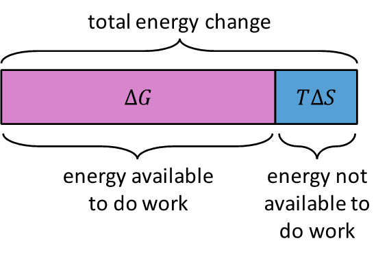

## Gibbs Free Energy

**Gibbs Free Energy (**$\mathbf{G}$**):** Refers to the amount of energy in a system that is available to do useful work.

ΔG = ΔH − TΔS

* **Standard molar Gibbs free energy of formation**

  **(**$\mathbf{\mathrm{\Delta}}\mathbf{G}_{\mathbf{f}}^{\mathbf{\theta}}$**):** This is the free energy change that accompanies the formation of one mole of a compound from its elements in their standard state

$\Delta G^\Theta = \Delta H - T\Delta S^\Theta_{system}$

**Predicting Spontaneity**

|**‎∆G**|**State of Reaction**|**Stability of Compound**|
|:---|:---|:---|
|Negative|Spontaneous|More stable|
|Positive|Not Spontaneous|Less stable|
|0|Equilibrium|-|

**An easier way to predict the spontaneity of a reaction with reference to temperature change,** Δ**H, and** Δ**S is to remember the four following cases:**

1. When ${\Delta}H$ is positive (reaction is **endothermic)**, and ${\Delta}S$ is negative (disorder is **decreasing**), then ${\Delta}G$ is **positive at every temperature** (reaction is non-spontaneous/impossible at any temp).

2. When ${\Delta}H$ is negative (reaction is **exothermic**), and ${\Delta}S$ is positive (disorder is **increasing**), then ${\Delta}G$ is **negative at every temperature** (reaction is spontaneous/feasible at any temp).

3. When ${\Delta}H$ is positive (reaction is **endothermic**), and ${\Delta}S$ is also positive (disorder is **increasing**), then ${\Delta}G$ is positive at **low temperatures** (where “−TΔS” is a small value compared to positive ΔH). ΔG becomes **more negative** as temperature increases.

4. When ${\Delta}H$ is negative (reaction is **exothermic**), and ${\Delta}S$ is also negative (disorder is **decreasing**), then ${\Delta}G$ is negative at **low temperatures** (where “−TΔS” is a small value compared to negative ΔH). ΔG becomes **more positive** as temperature increases.