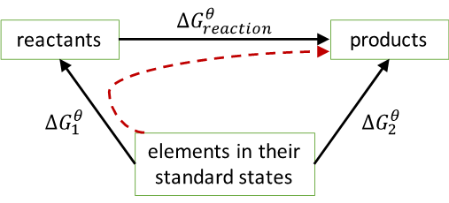

## Gibbs Free Energy Calculations

‎ 

$\mathrm{\Delta}G_\text{reaction}^{\theta} = \mathrm{\Delta}G_2^{\theta} - \mathrm{\Delta}G_1^{\theta}$

Form Hess’s cycle and calculate Free Energy as you would enthalpies
(using moles etc.)