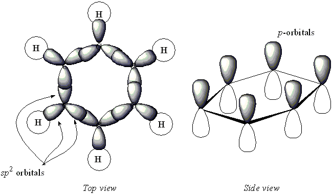

# Arenes

## Bonding in Benzene Ring ($C\\_{6}H\\_6$)

* Benzene is a symmetrical flat hexagonal planar molecule with all bond angles at $120^{\circ}$
- Consists of 6 C – C single bonds and remain electrons exist in
  delocalized system
- All C – C bonds in benzene are the same length (0.139nm) which are smaller than
  a normal C - C single bond but greater than a C = C double bond
- Each carbon forms 3 sigma bonds ($sp^{2}$ hybridised orbitals)
  - 2 between carbon and carbon (on either side)

  - 1 between carbon and hydrogen
- A p-orbital from each C atom overlaps above and below the plane of
  the ring forming two continuous loops; each C atom donates 1
  electron (6 in total) into this $\pi$ bond
* (These 6 electrons are said to be delocalised)