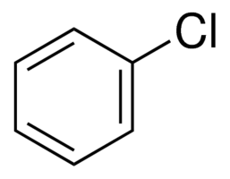
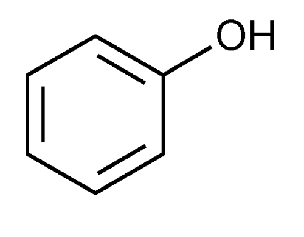
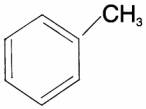
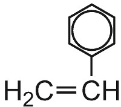
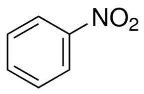
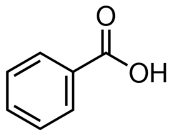
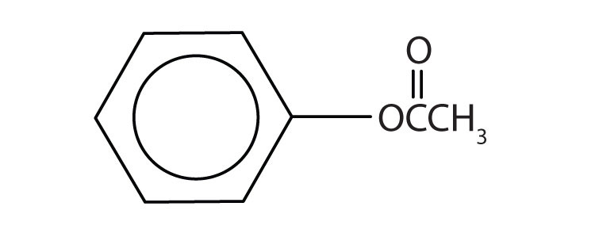

## Naming Aromatic Compounds

<table>
<tr>
<td>
<b>Name with Benzene</b>
</td>
<td>
<b>Name with Phenyl</b>
</td>
</tr>
<tr>
<td> <strong>Chlorobenzene</strong></td>
<td>‎ <strong>Phenol</strong></td>
</tr>
<tr>
<td>‎ <strong>Methylbenzene</strong></td>
<td>‎ <strong>Phenylethene</strong></td>
</tr>
<tr>
<td>‎ <strong>Nitrobenzene</strong></td>
<td>‎ <strong>Phenylamine</strong></td>
</tr>
<tr>
<td> <strong>Benzoic acid</strong></td>
<td> <strong>Phenyl ethanoate</strong></td>
</tr>
</table>