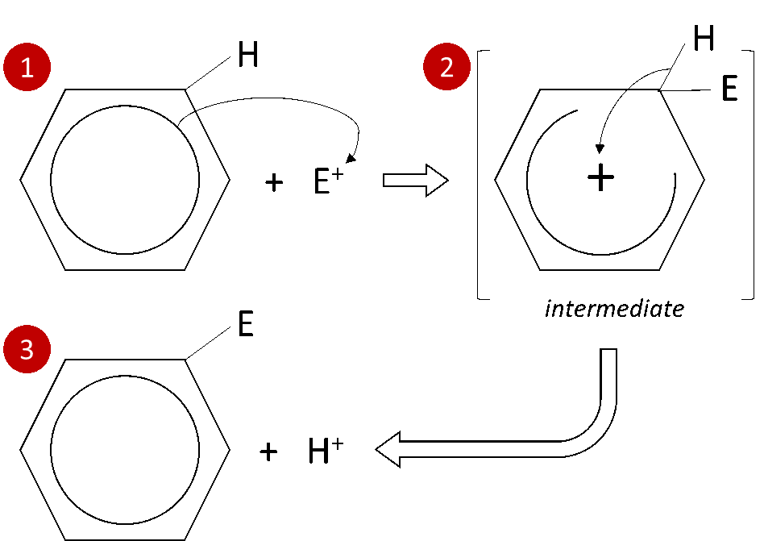

## Electrophilic Substitution Mechanism

* Electrophilic substitution: The replacement of an atom or a group of atoms after an initial attack by an electrophile
* Arenes prefer undergoing electrophilic substitution over addition because addition of a group would require the delocalized electron ring to break resulting in a loss of stabilization.
- An H-atom on the ring can be substituted by other atoms/groups of atoms
- All carbon atoms are identical and the benzene ring is symmetrical and, hence, any
  H-atom can be substituted
- An electrophile (E$^{+}$) can attack the ring of $\pi$
  e$^{-}$s but benzene is highly stable, so E$^{+}$ must be
  very strong
- A +ve ion can be generated by heterolytic fission of a covalent bond and,
  hence, a catalyst is needed to generate E$^{+}$

**Mechanism:**

1. E$^{+}$ attacks $\pi$ e$^{-}$ ring, accepting a pair
   of e$^{-}$ from benzene

2. An intermediate +ve species is formed in which the +ve charge is
   delocalized around the ring (which is more stable than a regular carbocation)

3. A proton ($H^{+}$) is eliminated from the +ve intermediate to restore stability and
   $\pi$ system of delocalized e$^{-}$ is reformed