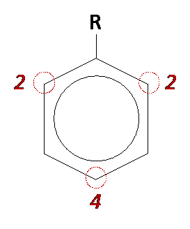
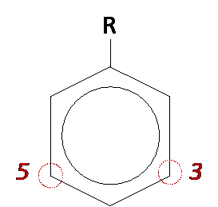

## Ring Activating and Deactivating Groups

|**Ring Activating**|**Ring Deactivating**|
|:---|:---|
|
 Single-bond groups such as Alkyls, NH2, OH
|
Groups with multiple such as CHO, COR, NO2, COOH
|
|Donates e- to the ring|Withdraws e- from ring|
|+ve inductive effect|-ve inductive effect|
|Increase e- density at position 2, 4 and 6, so substitution occurs at these positions|Decrease e- density at positions 2, 4, and 6, so substitution occurs at 3 and 5 positions|
|Thus, elec-substitution is faster and occurs under milder conditions|Thus, elec-substitution is slower and occurs under harsher conditions|
|||

**Exception:** Chlorine is ring deactivating but it directs incoming groups to 2,4,6 position