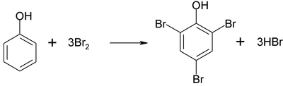
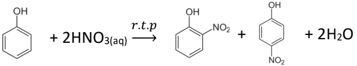
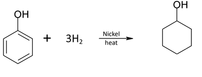

## Reaction with Benzene Ring

### **Bromination**

- Type of reaction:

  - electrophilic substitution

- Reagent:

  - aq. Bromine

- Condition:

  - r.t.p. (no catalyst)

- Rapid reaction, bromine decolourises, and white ppt. (2,4,6-tribromophenol) and misty fumes (HBr) form

- No catalyst needed since Br2 molecule easily polarized by activated benzene ring, with increased ­e- density in ring

### **Nitration**

‎

- Type of reaction:

  - electrophilic substitution

- Reagent:

  - dilute nitric acid

- Condition:

  - r.t.p. (again, due to activated benzene ring)

- If concentrated nitric acid used, then trinitrophenol is produced:

### **Reduction**

* Type of reaction:

  * reduction

* Reagent:

  * Hydrogen

* Conditions:

  * Nickel catalyst and heat

* Product is cyclohexanol and it is a secondary alcohol