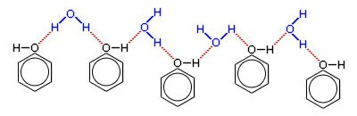

## Solubility and Acidity of Phenol

‎

* OH group forms H-bonds with water molecules. However, the large non-polar benzene ring disrupts the H-bonding, hence making phenol only partially soluble in water

* Solution of phenol is slightly acidic because the O-H in phenol breaks
  to form H+

* The bond breaks readily because the phenoxide ion formed is stabilized by
  partial delocalization of –ve charge over the benzene ring

  

- The conjugate base (phenoxide) is stable and less likely to react
  with H+ going back to phenol

- Thus, phenol is a stronger acid than $H_{2}O$ and ethanol, but it is still weaker than carboxylic acids