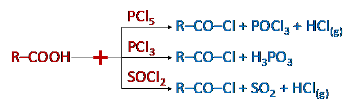
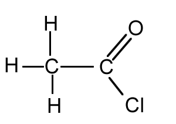

# Acyl Chlorides

## Preparation of Acyl Chlorides

‎  

* These are derivatives of carboxylic acids; -OH functional group of acid replaced
  by Cl.

  Note: Only the $PCl_3$ reaction requires special conditions (i.e. heat); reactions with $PCl_5$ and $SOCl_2$ take place at r.t.p.

* $SOCl_2$ is considered the best reagent since the acyl chloride formed is the most pure (both side-products are gases)

  ‎  

* Named after the corresponding acid using the suffix –oyl followed by chloride
  like the above image is ethanoyl chloride.