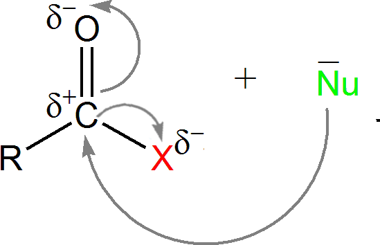

## Reactivity of Acyl Chlorides

* Acyl chlorides are much more reactive than the carboxylic acid from which they are derived.
* The polarity of both C$=$O and C—Cl bond produces relatively large
  $\delta$*+ charge on the carbon, making it e- deficient
  and more susceptible to attack by a nucleophile.*

