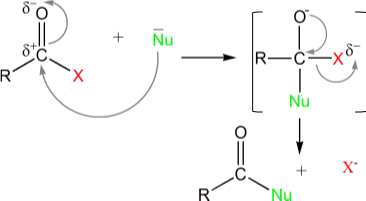
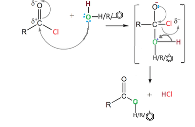

## Addition-Elimination Mechanism

‎

- The carbonyl carbon being highly e- deficient is attacked
  by nucleophile

- The Nu bonds to the carbon atom, the C$=$­O bond is broken leaving
  O with –ve charge

- Chloride (X) is lost and carbonyl double bond is reformed

* The mechanism of such condensation reactions is called **addition-elimination**

* Eg. the mechanism of the esterification of acyl chlorides:

* Note: the “Nu” in this case is either water, an alcohol, or phenol

