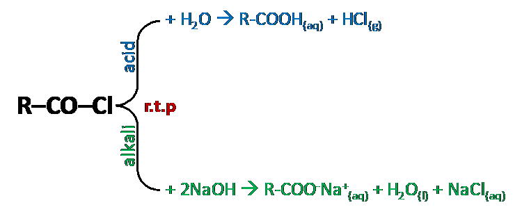
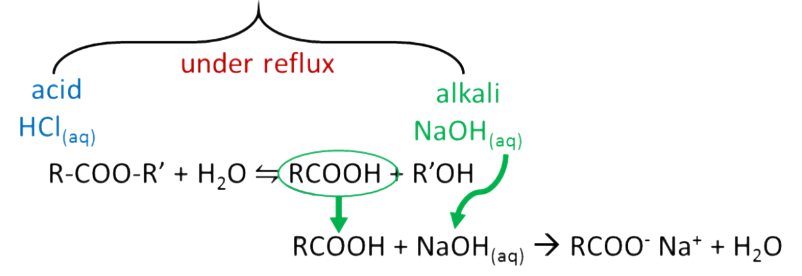

## Condensation Reactions

* Mechanism:

  * addition-elimination

Note: All reactions with acyl chlorides happen under r.t.p. because acyl chloride is reactive and doesn’t require catalyst or extreme conditions for reactions to place

**Hydrolysis**

**Forming Amides**

- Primary amides:

  - R—CO—Cl + NH3 →R—CO—NH2 + HCl

  - Reagent: ammonia

  - condition: r.t.p

    

- Secondary amides:

  - R—CO—Cl + R’NH2 → R—CO—NHR’ + HCl

  - Reagent: alkyl amine

  - condition: r.t.p

    

- Note: If excess NH3 used,
  the HCl formed is neutralized to NH4Cl

**Esterification**

- R—CO—Cl + HO–R → R–CO–OR(aq) + HCl(aq)

- Reagent & Condition:

  - Aliphatic alcohol at r.t.p

    

- Hydrolysis of esters:

