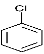
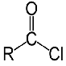

## Relative Ease of Hydrolysis

$-$<i>Increasing ease of hydrolysis</i>$\rightarrow$

|Aryl Chlorides|Alkyl Chlorides|Acyl Chlorides|
|:---|:---|:---|
||
R–Cl
||

* **Aryl chlorides** do not undergo hydrolysis at r.t.p because the
  p-orbitals from chlorine overlap with delocalized p-electrons giving
  the C–Cl bond a double bond character
* **Alkyl chlorides** require a strong alkali (NaOH) under reflux to
  be hydrolysed as carbon doesn’t have a high $\delta$+
* **Acyl chlorides** undergo hydrolysis with neutral water at r.t.p
  because the carbon atom is bonded to two highly electronegative
  atoms. Hence, the C has a high $\delta$+ and the attack by a nucleophile
  is much more rapid