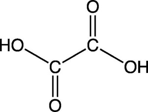

## Oxidation of Carboxylic Acids

* Only some carboxylic acids can be further oxidised, specifically methanoic acid and ethanedioic acid

Acid + Oxidizing Agent (warm) $\rightarrow$ CO2 + H2O

**Methanoic Acid**

- HCOOH + $\lbrack$O$\rbrack$ $\rightarrow$ CO2 + H2O

- With Tollens’ Reagent:

  - Ag+ gets reduced to silver – silver mirror formed

- With Fehling’s Solution:

  - Cu2+ gets reduced to Cu+ – copper(I) oxide
    (red)

- Note: can use stronger $\lbrack$O$\rbrack$ agents; Mn or Cr

**Ethanedioic Acid**

- HOOC–COOH + $\lbrack$O$\rbrack$ $\rightarrow$ CO2 + H2O

- With warm Acidified Manganate(VII) - KMnO4/H+:

  - Purple/pink to colourless

- Note: can also use Acidified Dichromate(VI)

  - Changes from orange to green

- Below is the ionic equation for this redox reaction:

  $2MNO_{4}^- + 6H^+ + 5H_{2}C_{2}O_{4} \rightarrow 2Mn^{+2} + 10CO_{2} + 8H_{2}O $