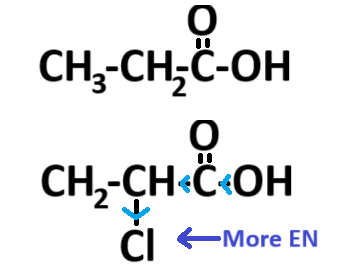

## Chlorine Substituted Acids

**Acidity of carboxylic acids increases when the C-atom bonded to -COOH is itself bonded to electron-withdrawing atoms (e.g. Cl)**

- The greater the number of Cl-atoms, the greater the polarisation and weaking of the O-H bond is. The acid ionises more as a result

- Conjugate base (the anion formed during ionisation of acid) is more stabilized due to the extended delocalization of the negative charge on the –COO-, and so it less likely to bond with a H+ ion

 

**Remember:**

- If an e- donating gp. is present, the molecule less acidic

- If an e- withdrawing gp. is present, the molecule more acidic