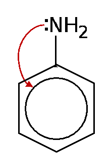
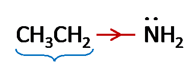

## Relative Basicity

‎ 

<table>
<tr>
<td bgcolor="red" align=center><strong>Phenyl amine weaker than ammonia</strong></td>
<td rowspan=5 bgcolor=#00cc00 align=center>

<strong>Ammonia</strong>

</td>
<td bgcolor=#990099 style="color:#ffffff" align=center><strong>Ethylamine stronger than ammonia</strong></td>
</tr>
<tr class="odd">
<td></td>
<td>‎</td>
</tr>
<tr class="even">
<td>Lone pair of e-s on N gets partially delocalized by interaction with benzene e- cloud</td>
<td>Ethyl e- donating group, increases e- density on N</td>
</tr>
<tr class="odd">
<td>Lone pair less available for coordination to proton</td>
<td>Enhanced ability to donate lone pair of e-s to proton</td>
</tr>
<tr class="even">
<td></td>
<td>Alkyl ammonium cation formed more stable than NH4+ cation from ammonia</td>
</tr>
</table>