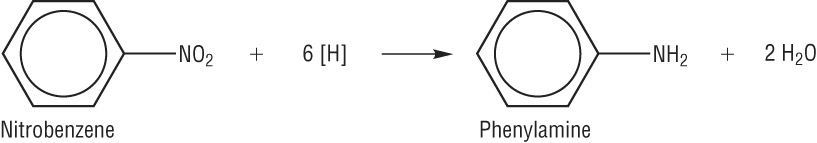

## Formation of Phenylamine‎

- Nitrobenzene is formed by nitration of benzene using $HNO_3$ and $H_2SO_4$ at 50°C. Nitrobenzene is reduced to form phenylamine.

- Type of reaction:

  - reduction (of nitrobenzene)

- Reagent:

  - conc. HCl with tin (Sn)

- Condition:

  - heat (under reflux)