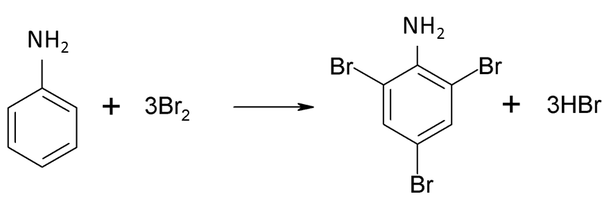

## Reactions of Phenylamine

**Bromination**

- Type of reaction:

  - electrophilic substitution

- Reagent:

  - aq. Bromine

- Conditions:

  - r.t.p. (no catalyst, since the greater electron density in benzene ring makes it a stronger nucleophile)

- Forms 2,4,6-tribromophenylamine (since the 2, 4, and 6 positions around the benzene ring have been activated by the electron-donating $-NH_{2}$)

- Note: White ppt. forms

**Diazotization**

(Benzene ring)–N2+ is called diazonium ion

- Type of reaction:

  - diazotization reaction (it is the 1st step in the making of an azo dye)

- Reagent:

  - nitrous acid (NaNO2 with excess HCl(aq))

  - *(HNO2 is a weak, unstable acid, so it has to be produced in a test tube by the reaction of NaNO2 with excess HCl)*

- Condition:

  - low temp. (less than 10${^\circ}$C)

- Note:

  - Diazonium salts of aryl amine are stabilized by delocalization of
    –N2+ ion’s e-s over the benzene
    ring

  - However, the diazonium ion highly is unstable and can decompose at higher temperatures, giving off N2 gas

- When diazonium chloride is warmed, phenol is formed along with $N_2$(seen as efferevesence) and $HCl$