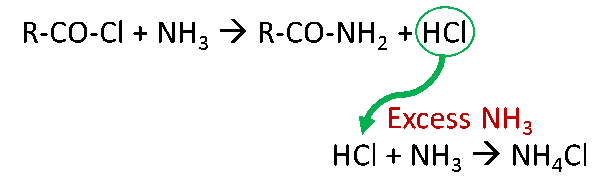
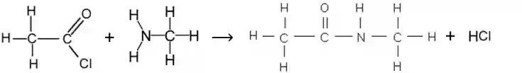

## Formation of Amides

**Formation of:**

* Primary Amides:

Note: If NH3(aq) is used in excess, HCl may react with it

* Substituted (secondary) Amides:

Note: If there is an excess of amine, it will react with the HCl formed, making its salt

* Type of reaction:

  * nucleophilic substitution

* Reagent:

  * conc. NH3(aq)

* Condition:

  * r.t.p.

* Example of the formation of a substituted amide:

  ‎ 

  ethanoyl chloride + methyl amine $\rightarrow$ N-methyl methanamide

  * Note: If there is an excess of methyl amine, it will react with the HCl formed, making CH3NH3$^{+}$Cl$^{-}$