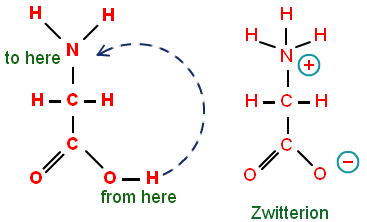

## Acid/Base Properties of Amino Acids

- The basic amino group and the acidic carboxyl group interact:

  - Carboxyl group donates a proton to amino group

  - Amino group accepts proton and zwitterion formed

- **Zwitterion:** An ion that carries two charges (+ve and -ve)

- Amino acids are  solids at r.t.p. due to ionic bonds that exist between
  zwitterions

- Presence of zwitterions means that amino acids are soluble in water

- **Isoelectric point**: pH value at which overall charge on the amino acid is zero (amino acid will be a zwitterion at its isoelectric point)

- Different amino acids have different isoelectric points.