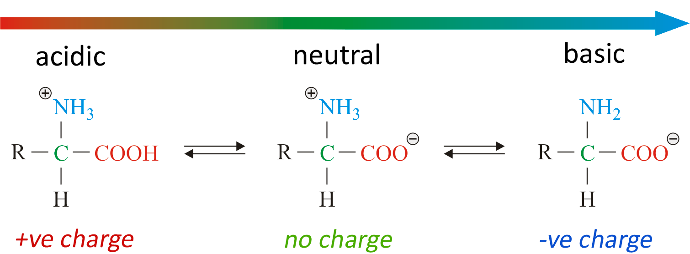

## Amino Acids in Acidic/Basic Conditions

- If an is acid added, the –COO- part of the zwitterion accepts
  an H+ ion, reforming –COOH group, resulting in a +vely charged ion

- If an alkali is added, the –NH3+ part of the
  zwitterion donates an H+ ion to the OH-,
  reforming –NH2 group and H2O, resulting in a -vely
  charged ion

‎