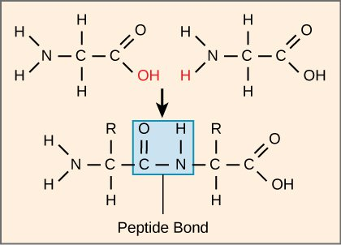

## Peptide Bonds

- Amide link is formed by the nucleophilic attack of the –NH2 group of
  one amino acid on the –COOH group of another. A dipeptide is formed:

- Reaction is a condensation reaction, as H2O is eliminated

- Reaction can continue to occur as product still has –NH2
  and –COOH group present, so this dipeptide can react to form a tripeptide:

Dipeptide $\rightarrow$ Tripeptide $\rightarrow$ Polypeptide ($\rightarrow$ Protein)

- Proteins are polymers of amino acids; many polypeptide chains held
  together by intermolecular forces)

**Hydrolysis of peptide bonds**

* (Similarly to the hydrolysis of amides) it involves breaking of peptide links by reaction with water catalysed by an acid or alkali catalyst, giving back the amino acids (temp. nearly 90oC)