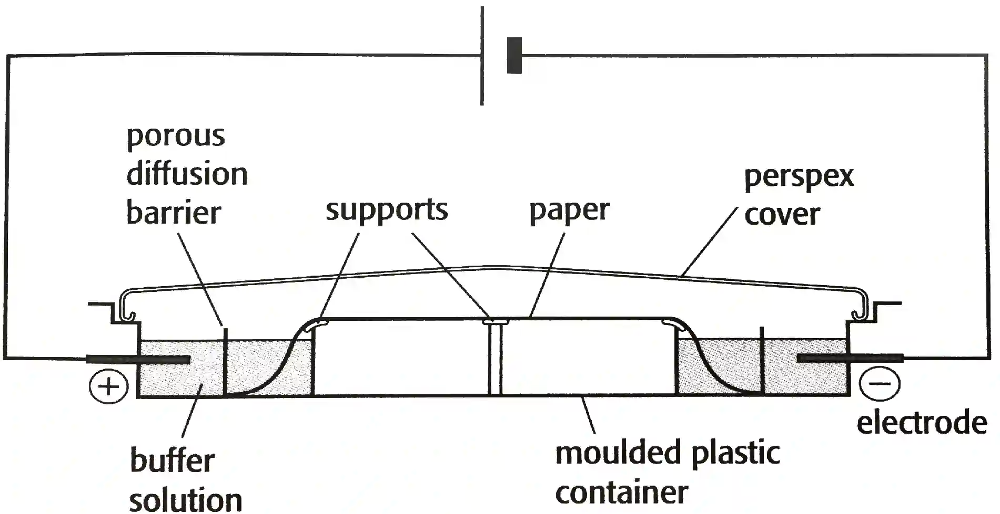
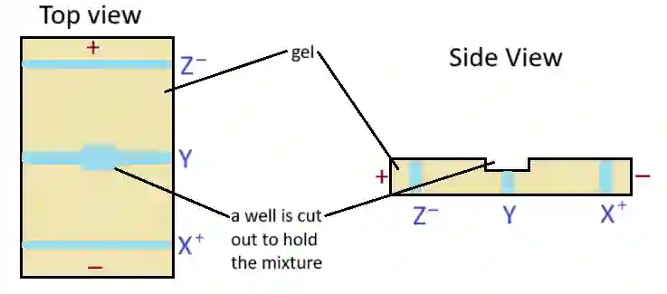

## Electrophoresis

- **Electrophoresis**: the separation of ions between a positive and negative electrode in an electric field

- Technique based on separating ions placed in an electric field. When
  sample placed between two electrodes:

  - +ve charge ions move towards –ve charged electrode

  - –ve charge ions move towards +ve charged electrode

- Sample placed on gel (or absorbent filter paper)

- Buffer solution carries ions along (back or forth)

Eg.

* Amino acids X,Y and Z have isoelectric points of 11,7 and 4 respectively.

* At a pH of 7, the amino acids present in samples of X, Y and Z are shown above

* Amino acid X gets a positive charge since pH 7 is lower than its isoelectric point, Amino acid Y will be neutrally charged (zwitterion) and Amino acid Z will have a negative charge since pH 7 is higher than its isoelectric point.

* Amino acid X will travel to negatively charged cathode since it’s positively charged, Amino Acid Y won’t show movement and and amino acid Z will move towards positively charged anode since it has a negative charge.

* If another positively charged amino acid was placed in the gel with a greater molecular mass than amino acid X, it will show movement towards the negative electrode but at a slower rate than X.

<table>
<thead>
<tr>
<th colspan=2>Factors that Determine the</th>
</tr>
</thead>
<tbody>
<tr>
<td><strong>Direction of Travel</strong></td>
<td><strong>Speed of Movement</strong></td>
</tr>
<tr>
<td>
pH of buffer solution

Charge on amino acid
</td>
<td>

Voltage applied

Temperature

Size (Mr) of amino acid

Magnitude of charge

</td>
</tr>
<tr>
<td colspan=2>
Larger ions with longer side chain move slower

More highly charge ions move faster
</td>
</tr>
</tbody>
</table>